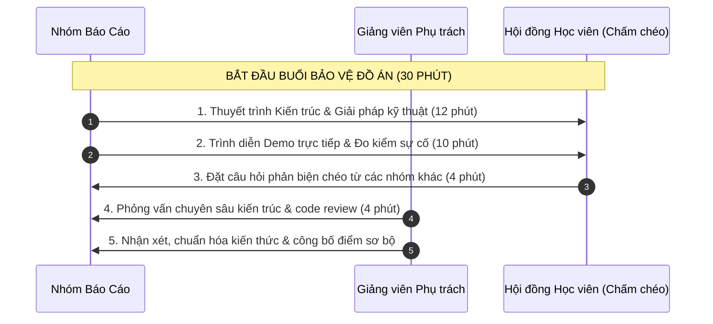

# Barem & Rubric Đánh Giá Đồ Án Chuyên Đề PKI (Thang điểm 100)

**Học phần:** Cơ sở hạ tầng khóa công khai (ATHK 512) - Lớp CHAT4P  
**Giảng viên phụ trách:** Nguyễn An Khương (Khoa Khoa học & Kỹ thuật Máy tính, Trường ĐHBK Tp. HCM · [ORCID: 0000-0002-9910-6387](https://orcid.org/0000-0002-9910-6387))  
**Thời gian bảo vệ:** Các buổi S07, S08, S09.  
**Cơ cấu điểm thi kết thúc học phần (KTHP):** Điểm đánh giá đồ án nhóm đóng góp **70%** điểm tổng kết học phần.

---

## 1. Bảng Tiêu Chí Đánh Giá Chi Tiết

| Trụ cột đánh giá | Trọng số | Tiêu chí chi tiết | Điểm tối đa |
|---|---|---|---|
| **Trụ cột 1: Kiến trúc & Tuân thủ Tiêu chuẩn** | **25%** | • Bản vẽ kiến trúc 3 tầng (Root CA, Intermediate CA, End-Entity) rõ ràng. • Tuân thủ nghiêm ngặt các RFC tương ứng (RFC 5280, RFC 3647, RFC 8555, RFC 6962, RFC 9881). • Phân tích mô hình đe dọa (Threat Modeling) và cơ chế cô lập khóa riêng biệt. | 25đ |
| **Trụ cột 2: Cài đặt Thực nghiệm & Demo Trực tiếp** | **35%** | • Môi trường container hóa (Docker Compose / Kubernetes) chạy mượt mà, không lỗi. • Có kịch bản tự động hóa (Makefile, Shell scripts, Python tooling). • Demo trực tiếp (Live Demo) thuyết phục: Cấp phát, Xác thực bắt tay, Thu hồi/Kiểm định hoặc Đo lường hiệu năng thực tế. | 35đ |
| **Trụ cột 3: Báo cáo Kỹ thuật & Phản biện** | **20%** | • Báo cáo kỹ thuật trình bày chuẩn mực khoa học, có sơ đồ luồng dữ liệu. • Phân tích số liệu đo lường cụ thể (Benchmark, Latency, Log trace). • Trả lời sắc bén, chính xác các câu hỏi phản biện từ Giảng viên và lớp học. | 20đ |
| **Trụ cột 4: Kỷ luật Kỹ thuật & Đóng góp Git** | **20%** | • Lịch sử commit Git đều đặn, tuân thủ Conventional Commits. • Phân công công việc minh bạch giữa các thành viên (dựa trên Git blame/PRs). • Tuyệt đối không rò rỉ khóa bí mật (Secret Scanning sạch 100%). | 20đ |
| **TỔNG CỘNG** | **100%** | **Đánh giá toàn diện năng lực Kỹ sư An toàn Thông tin Chuyên sâu** | **100đ** |

---

## 2. Quy Trình Bảo Vệ Chuẩn (30 phút / Nhóm)

---

## 3. Quy Định Chấm Chéo Học Viên (Peer Assessment)

* Mỗi nhóm khi nhóm khác báo cáo sẽ có **Phiếu chấm chéo** đánh giá độc lập theo 4 tiêu chí trên.
* Điểm chấm chéo chiếm **20%** trọng số thành phần đánh giá phản biện.
* Học viên đặt câu hỏi phản biện có chất lượng chuyên môn cao sẽ được cộng điểm chuyên cần/thưởng trực tiếp vào điểm cá nhân.
