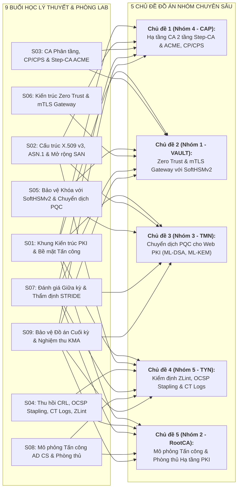
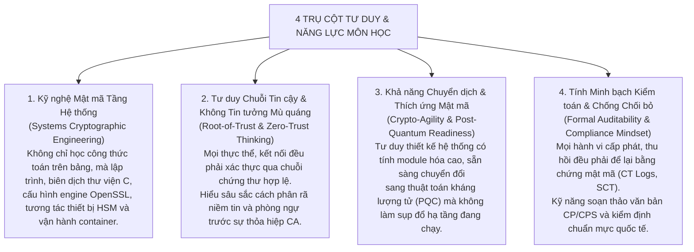
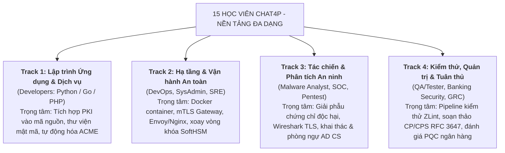

# CẨM NANG HỌC VIÊN TOÀN DIỆN (STUDENT MASTER HANDBOOK)
## HỌC PHẦN: CƠ SỞ HẠ TẦNG KHÓA CÔNG KHAI (PKI - ATHK 512)

**Lớp:** CHAT4P (Chương trình Chất lượng cao An toàn thông tin) · **Học kỳ:** HK1, Năm học 2026–2027  
**Cơ sở đào tạo:** Phân hiệu Học viện Kỹ thuật Mật mã tại TP. Hồ Chí Minh  
**Thời gian học:** 13h30 – 18h30 Thứ Bảy hàng tuần (9 buổi, bắt đầu từ 03/10/2026)  
**Địa điểm:** Tầng 2, Phòng 201/202/203, Cơ sở Nam Thành phố, Đường 15A, xã Bình Hưng, TP.HCM  
**Tổ chức GitHub học phần:** [KMA-PKI-261](https://github.com/KMA-PKI-261)

---

## LỜI MỞ ĐẦU DÀNH CHO HỌC VIÊN CHAT4P

Chào mừng toàn thể 15 học viên chính thức lớp Cao học An toàn thông tin CHAT4P đến với học phần **Cơ sở hạ tầng khóa công khai (Public Key Infrastructure - PKI)**.

Học phần này được thiết kế theo chuẩn đào tạo sau đại học tiên tiến, định hướng ứng dụng thực chiến chuyên sâu dành cho các kỹ sư, chuyên gia an ninh mạng đang công tác tại các tập đoàn công nghệ, viện nghiên cứu, trung tâm SOC, ngân hàng và cơ quan an ninh. Mục tiêu tối thượng của học phần không chỉ dừng lại ở lý thuyết mật mã trừu tượng, mà tập trung vào việc **làm chủ kiến trúc PKI cấp doanh nghiệp và quốc gia**, tự động hóa vòng đời chứng thư số (ACME/Step-CA), tích hợp mô-đun phần cứng bảo mật (HSM/PKCS#11), triển khai mTLS Gateway trong mô hình Zero Trust, và sẵn sàng lộ trình chuyển dịch sang **Mật mã Hậu lượng tử (Post-Quantum Cryptography - PQC)** theo các đạo luật và tiêu chuẩn mới nhất (NIST FIPS 203/204/205, Quyết định 1875/QĐ-TTg).

Tài liệu này là **Cẩm nang duy nhất** tổng hợp toàn bộ thông tin học vụ, quy chế, lộ trình, hướng dẫn kỹ thuật và tiêu chí đánh giá mà học viên cần nắm vững trong suốt 9 tuần học.

---

## 1. ĐỘI NGŨ ĐIỀU PHỐI & KÊNH LIÊN LẠC HỌC VỤ

| Vai trò | Nhân sự | Đơn vị / Chuyên môn | Kênh liên hệ | Nhiệm vụ chính |
| :--- | :--- | :--- | :--- | :--- |
| **Giảng viên phụ trách** | **Nguyễn An Khương** | Khoa Khoa học & Kỹ thuật Máy tính, Trường ĐHBK Tp. HCM | nakhuong@hcmut.edu.vn | Phụ trách toàn diện nội dung học thuật, giảng dạy, định hướng đề tài và đánh giá tổng kết |
| **Trợ giảng học phần (TA)** | **Mr. Nguyễn Hữu Hoàng Huy** | Cựu học viên CHAT3P, KMA TP.HCM | [LinkedIn Profile](https://www.linkedin.com/in/nguyen-huu-hoang-huy-abb138366/) | Hỗ trợ hạ tầng Docker/OpenSSL, giải đáp kỹ thuật Lab, kiểm tra Pull Request và chấm chéo |
| **Lớp trưởng CHAT4P** | **HV Tăng Triển Nguyên** | Lớp CHAT4P | triennguyen1911@gmail.com | Điều phối thông báo lớp, tổng hợp danh sách nhóm chuyên đề, cầu nối giữa lớp và Ban giảng dạy |

---

## 2. CHUẨN ĐẦU RA HỌC PHẦN (COURSE LEARNING OUTCOMES - CLO)

Hoàn thành học phần này, học viên đạt được các năng lực sau theo thang đo Bloom:

- **CLO 1 (Hiểu & Phân tích - Bloom 4):** Phân tích sâu sắc cấu trúc ASN.1 DER, thẩm định tính hợp lệ của chuỗi chứng thư số X.509v3 theo RFC 5280, nhận diện các điểm yếu logic trong quá trình xác thực chuỗi (path validation vulnerabilities).
- **CLO 2 (Thiết kế & Tích hợp - Bloom 5):** Thiết kế kiến trúc CA phân tầng (Two-Tier PKI: Root CA ngoại tuyến, Intermediate CA trực tuyến) đáp ứng yêu cầu bảo mật doanh nghiệp; tự động hóa cấp phát qua giao thức ACME (RFC 8555).
- **CLO 3 (Ứng dụng & Vận hành - Bloom 4):** Triển khai cơ chế kiểm tra trạng thái thu hồi chứng thư hiệu năng cao (CRL, OCSP, OCSP Stapling theo RFC 6960); tích hợp thiết bị phần cứng bảo mật qua chuẩn PKCS#11 (SoftHSMv2).
- **CLO 4 (Triển khai Hệ thống - Bloom 5):** Xây dựng hệ thống mTLS Gateway bảo vệ kiến trúc Microservices theo mô hình Zero Trust, thiết lập kiểm tra định danh dịch vụ nghiêm ngặt.
- **CLO 5 (Nghiên cứu & Chuyển dịch - Bloom 6):** Thực nghiệm đo lường hiệu năng và đánh giá lộ trình chuyển đổi Web PKI sang Mật mã Hậu lượng tử với các thuật toán chữ ký ML-DSA (RFC 9881) và trao đổi khóa ML-KEM theo FIPS 203/204/205.
- **CLO 6 (Làm việc nhóm & Phản biện - Bloom 5):** Làm việc nhóm chuyên môn cao, thực hiện phản biện kỹ thuật đối kháng, bảo vệ giải pháp trước hội đồng và tuân thủ liêm chính học thuật.

---

## 3. MÔ HÌNH LỚP HỌC ĐẢO NGƯỢC (FLIPPED CLASSROOM & LAB-FIRST)

Học phần triển khai mô hình **Flipped Classroom & Lab-First** với nhịp độ vận hành chặt chẽ:

1. **Giai đoạn Tiền buổi học (Tại nhà / Cơ quan):**
   - Nghiên cứu Slide, Handout & Lecture Notes được phát hành trước tối thiểu 3 ngày.
   - Kéo môi trường Docker của bài Lab mới và hoàn thành câu hỏi trinh sát (Reconnaissance Questions).
2. **Giai đoạn Tại lớp học (5 giờ thực chiến):**
   - **45–60 phút đầu:** Tóm lược nguyên lý lõi, phân tích ca thực tế & giải đáp thắc mắc.
   - **180–200 phút tiếp theo:** Toàn bộ lớp làm Lab thực hành. Giảng viên & TA kiểm tra, hỗ trợ trực tiếp.
   - **30–45 phút cuối:** Debriefing ca điển hình & đánh giá kết quả nghiệm thu tại lớp.
3. **Giai đoạn Hậu buổi học (GitHub Evidence Repository):**
   - Hoàn thiện mã nguồn & báo cáo kỹ thuật.
   - Mở Pull Request trên repo cá nhân để hệ thống CI tự động chạy kiểm thử.

---

## 4. LỘ TRÌNH 9 BUỔI HỌC VÀ MA TRẬN YÊU CẦU

| Buổi | Ngày | Chủ đề Lý thuyết | Trọng tâm Thực hành Lab | Tiêu chuẩn & Công cụ | Sản phẩm nộp |
| :---: | :---: | :--- | :--- | :--- | :--- |
| **S01** | 03/10 | Tổng quan PKI, Mô hình đe dọa & Khung pháp lý | **Lab 0:** Khởi tạo Evidence Repo, Docker Compose, Git signing | QĐ 1875/QĐ-TTg, RFC 5280, Docker | PR Lab 0, Form HV |
| **S02** | 10/10 | X.509, Cấu trúc ASN.1 & Chuỗi tin cậy | **Lab 1:** Mổ xẻ ASN.1, Khai thác lỗi chuỗi & ZLint Audit | RFC 5280, OpenSSL 3.5, dumpasn1, ZLint | PR Lab 1 + Log ZLint |
| **S03** | 17/10 | Quản trị CA & Vòng đời chứng thư | **Lab 2:** Xây dựng CA 2 tầng & Cấp phát tự động ACME | RFC 3647 (CP/CPS), RFC 8555, Step-CA | PR Lab 2 + Script ACME |
| **S04** | 24/10 | Thu hồi chứng thư & Quản lý khóa HSM | **Lab 3:** Thu hồi CRL/OCSP & Ký khóa qua SoftHSMv2 | RFC 6960 (OCSP), PKCS#11, SoftHSMv2 | PR Lab 3 + Log HSM |
| **S05** | 31/10 | Giao thức an toàn: TLS 1.3 & mTLS Gateway | **Lab 4:** Triển khai mTLS Gateway bảo vệ Microservices | RFC 8446 (TLS 1.3), Envoy Proxy, Nginx | PR Lab 4 + PCAP TLS |
| **S06** | 07/11 | Mật mã Hậu lượng tử & Lộ trình chuyển đổi | **Lab 5:** Benchmark ML-DSA (RFC 9881) & ML-KEM vs RSA | FIPS 203/204/205, OpenSSL 3.5 PQC | PR Lab 5 + Báo cáo PQC |
| **S07** | 14/11 | Bảo vệ Đồ án Chuyên đề Nhóm (Đợt 1) | Thuyết trình & Phản biện kỹ thuật: Nhóm 1 & Nhóm 2 | Tiêu chí Rubric KTHP, Phiếu chấm S07 | Repo Đồ án + Phiếu S07 |
| **S08** | 21/11 | Bảo vệ Đồ án Chuyên đề Nhóm (Đợt 2) | Thuyết trình & Phản biện kỹ thuật: Nhóm 3 & Nhóm 4 | Tiêu chí Rubric KTHP, Phiếu chấm S08 | Repo Đồ án + Phiếu S08 |
| **S09** | 28/11 | Bảo vệ Đồ án (Đợt 3) & Đối soát Điểm tổng kết | Thuyết trình Nhóm 5, Chấm chéo chéo cánh & Ký bảng điểm | Quy chế khảo thí KMA, Biên bản kết thúc | Bảng đối soát điểm S09 |

---

## 5. QUY CHẾ ĐÁNH GIÁ & CÔNG THỨC ĐIỂM KMA CHUẨN

Cơ cấu điểm số tuân thủ nghiêm ngặt quy chế của Học viện Kỹ thuật Mật mã (khớp 100% với tệp `Bang diem lop CHAT4P.xlsx`):

- **Điểm Học phần (Cột Q - DHP):** `ROUND(DQT*0.3 + KTHP*0.7, 1)`
- **Điểm Quá trình (Cột G & O - DQT):** `ROUND(TP1*0.7 + TP2*0.3, 1)`
- **Điểm Thành phần 1 (Cột E - TP1, trọng số 70% Điểm Quá trình = 21% Điểm Học phần):**
  - Điểm trung bình cộng của 5 bài thực hành Lab cá nhân (S02 đến S06): `TP1 = (Lab1 + Lab2 + Lab3 + Lab4 + Lab5) / 5`.
  - Mỗi bài Lab chấm theo thang điểm 10 dựa trên kịch bản kiểm thử tự động `verify.sh` (80%) và phần trả lời phản biện trực tiếp tại lớp (20%).
- **Điểm Thành phần 2 (Cột F - TP2, trọng số 30% Điểm Quá trình = 9% Điểm Học phần):**
  - Đánh giá mức độ chuyên cần tham gia đủ 9 buổi học tại giảng đường (kết hợp dữ liệu điểm danh thực tế và kết quả các bài Mini-Quiz đầu giờ).
- **Điểm Thi Kết thúc Học phần (Cột P - KTHP, trọng số 70% Điểm Học phần):**
  - Đánh giá Đồ án Chuyên đề Kỹ thuật theo nhóm, bảo vệ trực tiếp trước Hội đồng trong các buổi S07, S08, S09.
  - Cơ cấu thành phần KTHP:
    - **Mã nguồn & Demo vận hành hệ thống (35%):** Hệ thống chạy thực tế, đúng chuẩn kiến trúc bảo mật, có kịch bản chạy thử tự động qua Docker.
    - **Báo cáo Kỹ thuật Chuyên đề (25%):** Trình bày rõ ràng bài toán, mô hình đe dọa, thiết kế kiến trúc, phân tích mã nguồn và thảo luận kết quả thực nghiệm.
    - **Thuyết trình & Đối đáp Phản biện (25%):** Khả năng trình bày giải pháp tự tin, trả lời chính xác các câu hỏi chất vấn của Hội đồng.
    - **Điểm Đánh giá Chấm chéo giữa các Nhóm (15%):** Điểm số từ phiếu đánh giá khách quan của các nhóm phản biện đối kháng.

---

## 6. HƯỚNG DẪN THIẾT LẬP MÔI TRƯỜNG KỸ THUẬT

Để đảm bảo đồng bộ 100% môi trường thực hành và tránh lỗi phụ thuộc hệ điều hành máy trạm, học viên bắt buộc sử dụng hạ tầng Docker chuẩn do Ban giảng dạy cung cấp:

### 6.1. Yêu cầu cấu hình máy trạm
- Hệ điều hành: Linux (Ubuntu 22.04+), macOS (Apple Silicon / Intel), hoặc Windows 11 với WSL2.
- Phần mềm bắt buộc:
  - Git 2.30+
  - Docker Desktop 4.20+ hoặc Docker Engine 24.0+ & Docker Compose v2.20+
- Bộ nhớ RAM: Khuyến nghị tối thiểu 8GB RAM (16GB cho bài Lab 4 và Lab 5).
- Dung lượng đĩa trống: Tối thiểu 20GB.

### 6.2. Các bước khởi tạo nhanh
```bash
# 1. Clone repository học liệu chung
git clone https://github.com/KMA-PKI-261/PKI-261-Courseware.git
cd PKI-261-Courseware

# 2. Khởi tạo môi trường Docker chuẩn hóa
cd 1_NGUON-HOC-LIEU/labs/lab0-onboarding
docker compose build
docker compose up -d

# 3. Kiểm tra các công cụ cốt lõi bên trong container
docker compose exec pki-box openssl version
# Kết quả yêu cầu: OpenSSL 3.5.0 hoặc mới hơn có hỗ trợ PQC
docker compose exec pki-box dumpasn1 -v
docker compose exec pki-box zlint -v
docker compose exec pki-box softhsm2-util -v
```

---

## 7. ĐẶC TẢ CHI TIẾT 5 BÀI THỰC HÀNH LAB CÁ NHÂN

### Lab 1: Mổ xẻ ASN.1 & Thẩm định Chuỗi Chứng thư số X.509 (Buổi S02)
- **Mục tiêu:** Nắm vững cấu trúc nhị phân ASN.1 DER, mổ xẻ các trường mở rộng X.509v3 (Basic Constraints, Key Usage, Extended Key Usage, SAN, AIA), khai thác các lỗi logic trong quá trình thẩm định chuỗi và kiểm toán tuân thủ bằng ZLint.
- **Yêu cầu kỹ thuật:**
  1. Phân tích tệp chứng chỉ nhị phân bị hỏng trường mở rộng và sửa lại bằng ASN.1 parser.
  2. Dựng chuỗi chứng thực gồm Root CA, Intermediate CA và Server Certificate; mô phỏng lỗi thiếu cờ isCA=true tại Intermediate CA và chứng minh lỗi Path Validation.
  3. Chạy công cụ ZLint kiểm toán chứng chỉ phát hành, đạt kết quả: 0 Lỗi nghiêm trọng (Errors), 0 Cảnh báo vi phạm RFC 5280.
- **Lệnh kiểm thử:** `bash verify.sh` -> Tất cả các test cases đạt [PASS].

### Lab 2: Thiết kế & Tự động hóa Hạ tầng CA 2 Tầng với Step-CA & ACME (Buổi S03)
- **Mục tiêu:** Thiết lập kiến trúc CA 2 tầng đạt chuẩn doanh nghiệp (Root CA ngoại tuyến và Subordinate CA trực tuyến), tự động hóa cấp phát chứng thư qua giao thức ACME (RFC 8555).
- **Yêu cầu kỹ thuật:**
  1. Khởi tạo Root CA tự ký với thuật toán ECDSA P-384, thời hạn 10 năm, cấu hình lưu trữ cách ly.
  2. Khởi tạo Intermediate CA do Root ký, nạp vào dịch vụ step-ca.
  3. Kích hoạt ACME Provisioner trên cổng 9000. Cấu hình Certbot hoặc step acme tự động yêu cầu cấp phát chứng thư cho domain nội bộ api.kma.internal với xác thực HTTP-01 / DNS-01.
  4. Viết kịch bản tự động gia hạn (Auto-renewal) trước khi chứng thư hết hạn.
- **Lệnh kiểm thử:** `bash verify.sh` -> Kiểm tra chuỗi cấp phát và dịch vụ ACME đạt [PASS].

### Lab 3: Cơ chế Thu hồi Chứng thư (CRL/OCSP) & Tích hợp SoftHSMv2 (Buổi S04)
- **Mục tiêu:** Triển khai hạ tầng thu hồi chứng chỉ số (CRL phân tán và OCSP Responder theo RFC 6960), cấu hình OCSP Stapling trên Reverse Proxy và bảo vệ khóa riêng CA bằng mô-đun HSM ảo (SoftHSMv2 qua PKCS#11).
- **Yêu cầu kỹ thuật:**
  1. Cấu hình SoftHSMv2 với SO PIN và User PIN an toàn. Tạo cặp khóa ký CA trực tiếp bên trong Hardware Security Module.
  2. Cấu hình OpenSSL PKCS#11 engine (libpkcs11.so) để thực hiện thao tác ký số chứng chỉ mà không bao giờ trích xuất khóa riêng ra bộ nhớ hệ thống.
  3. Phát hành danh sách thu hồi CRL và khởi chạy dịch vụ OCSP Responder trực tuyến.
  4. Thực hiện thu hồi chứng thư nghi vấn (Compromised); kiểm chứng client từ chối kết nối bằng truy vấn OCSP trực tiếp và kiểm tra OCSP Stapling cache.
- **Lệnh kiểm thử:** `bash verify.sh` -> SoftHSM token signing và OCSP Revoked status đạt [PASS].

### Lab 4: Kiến trúc mTLS Gateway cho Microservices (Buổi S05)
- **Mục tiêu:** Triển khai mô hình bảo mật Zero Trust cho hệ thống phân tán sử dụng Mutual TLS (mTLS) trên nền tảng Envoy Proxy / Nginx, phân quyền truy cập dịch vụ dựa trên chứng thư định danh.
- **Yêu cầu kỹ thuật:**
  1. Thiết lập cụm 3 microservices (Frontend, Order Service, Payment Service).
  2. Triển khai Envoy Proxy làm Ingress/Sidecar Gateway thực thi mTLS bắt buộc giữa các dịch vụ.
  3. Cấu hình kiểm tra chứng thực client nghiêm ngặt: Xác thực chuỗi CA, kiểm tra trường SAN URI (SPIFFE ID), và từ chối mọi kết nối không có chứng thư hợp lệ.
  4. Bắt gói tin mạng bằng tcpdump và phân tích trên Wireshark, chứng minh toàn bộ dữ liệu trao đổi được mã hóa TLS 1.3 và định danh hai chiều an toàn.
- **Lệnh kiểm thử:** `bash verify.sh` -> Kết nối mTLS thành công, kết nối thiếu cert bị từ chối 403 Forbidden.

### Lab 5: Mật mã Hậu lượng tử (PQC) - Benchmark ML-DSA & ML-KEM (Buổi S06)
- **Mục tiêu:** Triển khai thực nghiệm các thuật toán mật mã hậu lượng tử mới nhất theo tiêu chuẩn NIST FIPS 203/204/205 và RFC 9881, đánh giá độ trễ và kích thước chuỗi chứng thư số PQC so với RSA/ECC cổ điển.
- **Yêu cầu kỹ thuật:**
  1. Sử dụng OpenSSL 3.5 biên dịch kèm thư viện liboqs để sinh cặp khóa và chứng chỉ số X.509 sử dụng thuật toán ML-DSA-44, ML-DSA-65, và ML-DSA-87.
  2. Thiết lập máy chủ thử nghiệm hỗ trợ cơ chế trao đổi khóa lai (Hybrid Key Exchange X25519 + ML-KEM-768).
  3. Viết kịch bản tự động đo lường và lập bảng so sánh hiệu năng 4 tiêu chí: (1) Kích thước khóa công khai/khóa riêng, (2) Kích thước chứng thư X.509, (3) Thời gian bắt tay TLS Handshake, (4) Tải CPU khi thực hiện 1.000 kết nối đồng thời.
- **Lệnh kiểm thử:** `bash verify.sh` -> Toàn bộ chuỗi chứng thực PQC hợp lệ và báo cáo số liệu benchmark xuất thành công.

---

## 8. HƯỚNG DẪN ĐỒ ÁN CHUYÊN ĐỀ NHÓM (KẾT THÚC HỌC PHẦN - 70%)

### 8.1. Danh sách 5 Nhóm Kỹ thuật Đã Đăng ký Chính thức

Theo dữ liệu từ tệp đăng ký chính thức của lớp (`DS_Nhom_CHAT_4P_PKI.xlsx`), 15 học viên đã phân bổ vào 5 nhóm (mỗi nhóm 3 thành viên):

| Nhóm | Tên Nhóm | Trưởng nhóm | Thành viên nhóm | Ngành | Đơn vị công tác & Lĩnh vực | Buổi bảo vệ |
| :---: | :---: | :--- | :--- | :---: | :--- | :---: |
| **Nhóm 1** | **VAULT** | **Nguyễn Ngọc Hoài** | Nguyễn Trần Hoàng Long<br>Nguyễn Đình Quân | ATTT | AgileOps (DevOps) / An ninh mạng THD / ĐH Nguyễn Tất Thành | **Buổi S07** (14/11) |
| **Nhóm 2** | **RootCA** | **Nguyễn Vĩnh Hiển** | Nguyễn Ngọc Sơn<br>Nguyễn Trường Phú | CNTT | Dược Imexpharm / VinSmart Future / Cố vấn OWASP | **Buổi S07** (14/11) |
| **Nhóm 3** | **TMN Root of Trust** | **Võ Thông Minh** | Tăng Triển Nguyên<br>Trần Minh Triết | ATTT<br>CNTT | Ngân hàng Nam Á / Getz Pharma (Lớp trưởng) / OPSWAT | **Buổi S08** (21/11) |
| **Nhóm 4** | **CAP** | **Vũ Thị Diệu Anh** | Diệp Kim Chi<br>Đoàn Quang Phúc | CNTT<br>THƯD | TMA Solutions / Digityze Asia / Trung tâm 286 - Bộ Tư lệnh 86 | **Buổi S08** (21/11) |
| **Nhóm 5** | **TYN** | **Võ Minh Nhật** | Hồ Quốc Thái<br>Nguyễn Công Ý | CNTT | Đi học / Hitachi Digital Services / Ngân hàng ACB | **Buổi S09** (28/11) |

*Ghi chú:* Học viên Nguyễn Tuấn Anh (CHAT4P002) và Huỳnh Trần Trọng Nghĩa (CHAT4P011) được miễn học phần này theo quy định của Học viện, do đó lớp chính thức gồm 15 học viên chia đều vào đúng 5 nhóm chuyên đề (3 thành viên/nhóm).

### 8.2. Danh mục 5 chủ đề chuyên sâu đề xuất
### 8.3. Quy cách hồ sơ nghiệm thu đồ án
Trước ngày bảo vệ tối thiểu 48 giờ, mỗi nhóm phải gửi Pull Request vào repository chính của tổ chức `KMA-PKI-261` chứa đầy đủ các thành phần:
- Thư mục `/docs`: Báo cáo kỹ thuật định dạng Markdown và PDF (từ 25 đến 40 trang), chứa sơ đồ kiến trúc hệ thống, phân tích nguy cơ STRIDE, lược đồ thực thi và bảng đánh giá số liệu thực nghiệm.
- Thư mục `/src`: Toàn bộ mã nguồn, cấu hình hệ thống, Docker Compose và file cấu hình bảo mật.
- Tệp `README.md`: Hướng dẫn triển khai hệ thống One-Click Deploy với `docker compose up -d`.
- Tệp `demo_script.sh`: Kịch bản trình diễn trực tiếp các tính năng an toàn cốt lõi.

### 8.3. Ma trận chấm chéo đối kháng
Trong các buổi bảo vệ S07, S08, S09, nhóm phản biện đối kháng có nhiệm vụ lắng nghe, đặt tối thiểu 3 câu hỏi kỹ thuật hóc búa và đánh giá vào **Phiếu chấm chéo nhóm**. Điểm chấm chéo đóng góp 15% vào điểm KTHP của nhóm báo cáo.

---

## 9. QUY ĐỊNH NỘP BÀI GITHUB & LIÊM CHÍNH HỌC THUẬT

### 9.1. Quy ước đặt tên Repository và Nhánh
- Mỗi học viên được cấp một repository cá nhân theo định dạng: `KMA-PKI-261/PKI-261-<MSHV>` (Ví dụ: `KMA-PKI-261/PKI-261-2601001`).
- Quy ước nhánh phát triển:
  - Nhánh `main`: Nhánh ổn định, chỉ chứa các phiên bản đã nghiệm thu.
  - Nhánh bài Lab: `lab-1`, `lab-2`, `lab-3`, `lab-4`, `lab-5`.
- Nộp bài bằng cách tạo Pull Request từ nhánh `lab-x` vào `main`.

### 9.2. Ký số Git Commit (GPG / SSH Commit Signing)
Nhằm rèn luyện văn hóa an toàn thông tin chuyên nghiệp, toàn bộ commit nộp bài bắt buộc phải được ký số điện tử (Verified commit). Học viên cấu hình theo hướng dẫn:
```bash
# Cấu hình ký commit bằng SSH Key cá nhân
git config --global user.name "Họ và Tên Học Viên"
git config --global user.email "email-hoc-vien@domain.com"
git config --global gpg.format ssh
git config --global user.signingkey ~/.ssh/id_ed25519.pub
git config --global commit.gpgsign true
```

### 9.3. Liêm chính học thuật (Academic Integrity)
- Tuyệt đối nghiêm cấm sao chép nguyên văn mã nguồn, cấu hình hoặc báo cáo của người khác mà không trích dẫn nguồn rõ ràng.
- Mọi trường hợp gian lận hoặc nộp bài trùng lặp sẽ nhận điểm 0 cho bài thực hành tương ứng và bị ghi nhận biên bản học vụ.
- Học viên được khuyến khích sử dụng các công cụ trợ lý AI (như Claude, ChatGPT, Gemini) để hỗ trợ tìm kiếm tài liệu, giải thích cú pháp mã lệnh và hỗ trợ gỡ lỗi cú pháp, nhưng **tuyệt đối không để AI làm thay tư duy kiến trúc và phải tự giải thích được từng dòng lệnh trước Giảng viên và Trợ giảng**.

---

## 10. SỔ TAY GỠ LỖI KỸ THUẬT THỰC CHIẾN (TROUBLESHOOTING & FAQS)

### FAQ 1: Phiên bản OpenSSL trên máy chủ không hỗ trợ PQC?
- **Nguyên nhân:** Các bản phân phối Linux thông thường (như Ubuntu 22.04 LTS) mặc định đi kèm OpenSSL 3.0.x chưa tích hợp bộ thuật toán PQC (FIPS 203/204/205).
- **Khắc phục:** Sử dụng container `pki-box` đi kèm trong thư mục `1_NGUON-HOC-LIEU/labs/` đã được cài đặt sẵn OpenSSL 3.5.0 kèm module liboqs.

### FAQ 2: Lỗi cổng mạng Docker bị chiếm dụng (Port Binding Error)?
- **Hiện tượng:** `Error response from daemon: driver failed programming external connectivity: bind: address already in use: 0.0.0.0:9000`
- **Khắc phục:** Kiểm tra tiến trình đang chiếm cổng bằng `lsof -i :9000` (macOS/Linux) hoặc `netstat -ano | findstr :9000` (Windows), sau đó dừng dịch vụ xung đột hoặc đổi cổng ánh xạ trong tệp `docker-compose.yml`.

### FAQ 3: Token SoftHSM bị khóa PIN do nhập sai quá nhiều lần?
- **Hiện tượng:** `CKR_PIN_LOCKED` khi gọi OpenSSL PKCS#11 engine.
- **Khắc phục:** Xóa và khởi tạo lại token slot bằng lệnh:
  ```bash
  softhsm2-util --delete-token --token "KMA-PKI-Token"
  softhsm2-util --init-token --slot 0 --label "KMA-PKI-Token" --so-pin 12345678 --pin 1234
  ```

### FAQ 4: Trình duyệt từ chối kết nối mTLS với lỗi `ERR_BAD_SSL_CLIENT_AUTH_CERT`?
- **Nguyên nhân:** File chứng thư cá nhân chưa được nhập vào Keychain của OS hoặc chưa export ra định dạng PKCS#12 (`.p12` hoặc `.pfx`).
- **Khắc phục:** Chuyển đổi chứng chỉ và khóa riêng sang định dạng PKCS#12:
  ```bash
  openssl pkcs12 -export -out client.p12 -inkey client.key -in client.crt -certfile ca.crt
  ```
  Sau đó import file `client.p12` vào trình duyệt hoặc Keychain của hệ điều hành.

---


---

## 4. MA TRẬN ÁNH XẠ GIỮA 9 BUỔI HỌC VÀ 5 CHỦ ĐỀ ĐỒ ÁN (MAPPING INFOGRAPHIC)

Để học viên hình dung rõ ràng lộ trình học tập, từng buổi học lý thuyết và thực hành đều được thiết kế để trực tiếp cung cấp khối kiến thức và thành phần công nghệ cho 5 đề tài đồ án chuyên sâu:



### Bảng Phân Tích Ma Trận Kế Thừa Tri Thức:

| Buổi học | Nội dung Trọng tâm Buổi học | Đóng góp Trực tiếp cho 5 Chủ đề Đồ án Nhóm |
|:---:|---|---|
| **S01** | Bối cảnh thể chế (QĐ 1875), 3 mô hình PKI, nguyên tắc Root CA offline | **Cả 5 Nhóm:** Nền tảng thiết kế kiến trúc phân tầng, xác định ranh giới niềm tin và bề mặt tấn công. |
| **S02** | Giải phẫu ASN.1 DER, Basic Constraints, Key Usage, SAN | **Nhóm 1, 3, 4, 5:** Cấu hình chính xác tệp mở rộng OpenSSL, tạo chứng chỉ máy chủ có SAN, kiểm soát cờ CA. |
| **S03** | Khởi tạo CA 2 tầng, CP/CPS RFC 3647, Step-CA & ACME RFC 8555 | **Nhóm 4 (Trọng tâm) & Nhóm 1:** Xây dựng máy chủ Step-CA ACME tự động hóa; hoàn thiện bộ quy chế CP/CPS 9 mục. |
| **S04** | Thu hồi CRL v2, OCSP Responder, OCSP Stapling, CT Logs, ZLint | **Nhóm 5 (Trọng tâm) & Nhóm 2:** Triển khai OCSP Responder thời gian thực, tích hợp linter ZLint vào CI/CD. |
| **S05** | Cryptoki API PKCS#11, Token SoftHSMv2, Bộ chuẩn PQC NIST (FIPS 203/204) | **Nhóm 3 (Trọng tâm) & Nhóm 1:** Nhóm 3 làm chủ OpenSSL 3.5 + liboqs; Nhóm 1 tích hợp SoftHSMv2 lưu khóa CA. |
| **S06** | Zero Trust (NIST SP 800-207), mTLS 2 chiều, định danh SPIFFE/SPIRE, Envoy Gateway | **Nhóm 1 (Trọng tâm):** Dựng cổng mTLS Gateway xác thực danh tính client dựa trên SAN URI SPIFFE ID. |
| **S07** | Đánh giá tiến độ giữa kỳ, mô hình đe dọa STRIDE, chấm chéo ngang hàng | **Cả 5 Nhóm:** Thẩm định thiết kế kỹ thuật, rà soát mô hình STRIDE và hoàn thành 50% khối lượng mã nguồn. |
| **S08** | Khai thác lỗ hổng cấu hình AD CS (ESC1/ESC8), Rogue CA, Phòng thủ đa tầng | **Nhóm 2 (Trọng tâm) & Nhóm 5:** Mô phỏng chuỗi tấn công chiếm quyền quản trị và xây dựng bộ lọc phòng ngự. |
| **S09** | Demo hệ thống trực tiếp trên Docker, vấn đáp chuyên sâu, đối soát bảng điểm KMA | **Cả 5 Nhóm:** Báo cáo tổng kết đồ án, bàn giao mã nguồn hoàn chỉnh và nghiệm thu kết quả học tập. |

---

## 5. Ý NGHĨA KHÓA SSH PUBLIC KEY & TƯ DUY - NĂNG LỰC CỐT LÕI CỦA MÔN HỌC

### 5.1. Khóa SSH Public Key Dùng để Làm Gì?

Trong học phần này, cặp khóa SSH (khuyến nghị thuật toán **Ed25519**) không chỉ là một công cụ tiện ích mà là hiện thân trực quan của mật mã bất đối xứng trong môi trường vận hành thực tế:
1. **Xác thực Không Cần Mật khẩu (Asymmetric Authentication):** Thay vì gửi mật khẩu dạng văn bản rõ qua mạng, SSH sử dụng giao thức bắt tay thử thách - đáp ứng (Challenge-Response): Máy chủ gửi một thông điệp ngẫu nhiên, máy trạm dùng khóa bí mật (`id_ed25519`) để ký số và máy chủ dùng khóa công khai (`id_ed25519.pub`) trên GitHub để xác minh. Mật khẩu không bao giờ rời khỏi máy của học viên.
2. **Ký Số Commit Bảo đảm Tính Toàn vẹn (Cryptographic Non-Repudiation):** Học viên cấu hình Git để ký số lên từng commit (`git commit -S`). GitHub sẽ hiển thị huy hiệu xanh **Verified**, chứng minh toán học rằng commit đó đích thực do chính học viên tạo ra, ngăn chặn hoàn toàn việc một người mạo danh email của người khác để commit mã nguồn bừa bãi.
3. **Quản trị Máy chủ Phân tán & Zero Trust Bastion Host:** Cặp khóa SSH là tấm thẻ định danh tối thượng để kỹ sư truy cập an toàn vào máy chủ CA ngoại tuyến, container kiểm thử và cổng quản trị hạ tầng mật mã.

### 5.2. Môn Học Này Huấn Luyện Tư Duy & Kỹ Năng Gì?

Học phần hướng tới việc đào tạo học viên trở thành những **Kỹ sư Hạ tầng Mật mã Thực chiến (Systems Cryptographic Engineers)** với 4 trụ cột năng lực:



---

## 6. DANH MỤC KHO THAM KHẢO CHUẨN QUỐC TẾ (GOLD STANDARD REPOSITORIES)

Để hoàn thiện đồ án đạt chất lượng xuất sắc, học viên từng nhóm cần chủ động nghiên cứu cấu trúc mã nguồn của các dự án nguồn mở chuẩn mực thế giới:

* **Chủ đề 1 (CA Hierarchy, Step-CA & ACME):**
  * `smallstep/certificates`: [github.com/smallstep/certificates](https://github.com/smallstep/certificates) — Máy chủ CA chuẩn mực phục vụ Zero Trust và ACME.
  * `certbot/certbot`: [github.com/certbot/certbot](https://github.com/certbot/certbot) — Client ACME chính thức của tổ chức Electronic Frontier Foundation (EFF).
  * `letsencrypt/boulder`: [github.com/letsencrypt/boulder](https://github.com/letsencrypt/boulder) — Hệ thống máy chủ ACME backend quy mô toàn cầu của Let's Encrypt.
* **Chủ đề 2 (Zero Trust, mTLS Gateway & SoftHSM):**
  * `opendnssec/SoftHSMv2`: [github.com/opendnssec/SoftHSMv2](https://github.com/opendnssec/SoftHSMv2) — Hiện thực HSM mềm chuẩn PKCS#11 quốc tế.
  * `envoyproxy/envoy`: [github.com/envoyproxy/envoy](https://github.com/envoyproxy/envoy) — Edge & Service Proxy hàng đầu về mTLS, RBAC và định danh SPIFFE.
  * `hashicorp/vault`: [github.com/hashicorp/vault](https://github.com/hashicorp/vault) — Hệ thống quản trị bí mật mật mã và PKI nội bộ doanh nghiệp.
* **Chủ đề 3 (PQC Migration for Web PKI):**
  * `open-quantum-safe/oqs-provider`: [github.com/open-quantum-safe/oqs-provider](https://github.com/open-quantum-safe/oqs-provider) — Provider OpenSSL 3 cho thuật toán hậu lượng tử.
  * `open-quantum-safe/liboqs`: [github.com/open-quantum-safe/liboqs](https://github.com/open-quantum-safe/liboqs) — Thư viện C nền tảng của Open Quantum Safe.
  * `open-quantum-safe/openssl`: [github.com/open-quantum-safe/openssl](https://github.com/open-quantum-safe/openssl) — Nhánh fork OpenSSL hỗ trợ thử nghiệm PQC.
* **Chủ đề 4 (ZLint, OCSP Stapling & CT Logs):**
  * `zmap/zlint`: [github.com/zmap/zlint](https://github.com/zmap/zlint) — Công cụ kiểm định tuân thủ tiêu chuẩn X.509 hàng đầu thế giới.
  * `google/certificate-transparency-go`: [github.com/google/certificate-transparency-go](https://github.com/google/certificate-transparency-go) — Thư viện CT Logs chuẩn của Google.
  * `cloudflare/cfssl`: [github.com/cloudflare/cfssl](https://github.com/cloudflare/cfssl) — Bộ công cụ PKI và thẩm định chứng thư của Cloudflare.
* **Chủ đề 5 (Tấn công & Phòng thủ Hạ tầng PKI):**
  * `GhostPack/Certify`: [github.com/GhostPack/Certify](https://github.com/GhostPack/Certify) — Công cụ kiểm toán và khai thác lỗ hổng cấu hình AD CS kinh điển.
  * `ly4k/Certipy`: [github.com/ly4k/Certipy](https://github.com/ly4k/Certipy) — Bộ công cụ tấn công và phân tích hạ tầng Active Directory Certificate Services.
  * `dirkjanm/mitm6`: [github.com/dirkjanm/mitm6](https://github.com/dirkjanm/mitm6) — Công cụ khai thác DHCPv6 và NTLM relay tấn công xác thực CA.

---

## 7. QUY CHUẨN ĐÓNG GÓP GIT, LIÊM CHÍNH & KHẾ ƯỚC BẢO VỆ NHÁNH

### 7.1. Cam kết Đóng góp Cá nhân Hàng tuần (Individual Commitment)

* **Nghiêm cấm hiện tượng "dồn bài một commit cuối kỳ":** Mỗi thành viên trong nhóm phải commit đều đặn hàng tuần tương ứng với phân công công việc.
* **Quy chuẩn Thông điệp Commit (Conventional Commits):**
  * `feat: ...` (Tính năng kỹ thuật mới: sinh khóa, thêm route ACME)
  * `fix: ...` (Sửa lỗi cấu hình, vá phần mở rộng SAN)
  * `docs: ...` (Cập nhật báo cáo kỹ thuật, vẽ sơ đồ Mermaid)
  * `test: ...` (Thêm kịch bản kiểm thử, chạy lệnh verify)
  * `bench: ...` (Số liệu đo lường định lượng, benchmark hiệu năng)
* **Quy trình Pull Request & Review Chéo Nội bộ:**
  * Mỗi tính năng phải được phát triển trên nhánh riêng: `feat/<tên-tính-năng>`.
  * Sau khi hoàn tất, mở Pull Request vào nhánh chính `main`.
  * Bắt buộc phải có **ít nhất 1 thành viên khác trong nhóm review và approve** mới được gộp mã nguồn (merge).

### 7.2. Khế ước Xã hội Bảo vệ Toàn vẹn Nhánh (Anti-Force-Push Social Contract)

Trong trường hợp tài khoản người dùng không có quyền quản trị cấp Enterprise để thiết lập chính sách khóa nhánh cứng (Branch Protection Rules), toàn thể học viên các nhóm cam kết tuân thủ **Khế ước Toàn vẹn Mã nguồn**:
1. **Tuyệt đối không sử dụng `git push --force` hoặc `--force-with-lease`** lên nhánh `main`/`master`. Hành vi force push sẽ phá hủy lịch sử commit và làm sai lệch dữ liệu đánh giá đóng góp cá nhân.
2. **Duy trì Lịch sử Tuyến tính (Linear Git History):** Ưu tiên gộp nhánh bằng `Squash and Merge` hoặc `Rebase and Merge` kèm thông điệp rõ ràng.
3. **Đánh Dấu Thẻ Phiên bản (Release Tags):** Mỗi mốc tiến độ phải được gắn tag minh bạch:
   * `git tag -a v0.1-s03 -m "Hoàn thành khởi tạo CA 2 tầng"`
   * `git tag -a v0.5-midterm -m "Mốc đánh giá tiến độ giữa kỳ S07"`
   * `git tag -a v1.0-final -m "Bản phát hành chính thức nghiệm thu cuối kỳ"`
   * `git push origin --tags`
4. **Kiểm toán Dữ liệu Tự động:** Công cụ thu bài tự động của Giảng viên (`3_CONG-CU/thu-bai.py`) sẽ quét toàn bộ nhật ký commit (tác giả, email, thời gian và số lượng dòng thay đổi) để chấm điểm công bằng cho từng cá nhân.

---

## 4. MA TRẬN ÁNH XẠ GIỮA 9 BUỔI HỌC VÀ 5 CHỦ ĐỀ ĐỒ ÁN (MAPPING INFOGRAPHIC)

Để học viên hình dung rõ ràng lộ trình học tập, từng buổi học lý thuyết và thực hành đều được thiết kế để trực tiếp cung cấp khối kiến thức và thành phần công nghệ cho 5 đề tài đồ án chuyên sâu:


### Bảng Phân Tích Ma Trận Kế Thừa Tri Thức:

| Buổi học | Nội dung Trọng tâm Buổi học | Đóng góp Trực tiếp cho 5 Chủ đề Đồ án Nhóm |
|:---:|---|---|
| **S01** | Bối cảnh thể chế (QĐ 1875), 3 mô hình PKI, nguyên tắc Root CA offline | **Cả 5 Nhóm:** Nền tảng thiết kế kiến trúc phân tầng, xác định ranh giới niềm tin và bề mặt tấn công. |
| **S02** | Giải phẫu ASN.1 DER, Basic Constraints, Key Usage, SAN | **Nhóm 1, 3, 4, 5:** Cấu hình chính xác tệp mở rộng OpenSSL, tạo chứng chỉ máy chủ có SAN, kiểm soát cờ CA. |
| **S03** | Khởi tạo CA 2 tầng, CP/CPS RFC 3647, Step-CA & ACME RFC 8555 | **Nhóm 4 (Trọng tâm) & Nhóm 1:** Xây dựng máy chủ Step-CA ACME tự động hóa; hoàn thiện bộ quy chế CP/CPS 9 mục. |
| **S04** | Thu hồi CRL v2, OCSP Responder, OCSP Stapling, CT Logs, ZLint | **Nhóm 5 (Trọng tâm) & Nhóm 2:** Triển khai OCSP Responder thời gian thực, tích hợp linter ZLint vào CI/CD. |
| **S05** | Cryptoki API PKCS#11, Token SoftHSMv2, Bộ chuẩn PQC NIST (FIPS 203/204) | **Nhóm 3 (Trọng tâm) & Nhóm 1:** Nhóm 3 làm chủ OpenSSL 3.5 + liboqs; Nhóm 1 tích hợp SoftHSMv2 lưu khóa CA. |
| **S06** | Zero Trust (NIST SP 800-207), mTLS 2 chiều, định danh SPIFFE/SPIRE, Envoy Gateway | **Nhóm 1 (Trọng tâm):** Dựng cổng mTLS Gateway xác thực danh tính client dựa trên SAN URI SPIFFE ID. |
| **S07** | Đánh giá tiến độ giữa kỳ, mô hình đe dọa STRIDE, chấm chéo ngang hàng | **Cả 5 Nhóm:** Thẩm định thiết kế kỹ thuật, rà soát mô hình STRIDE và hoàn thành 50% khối lượng mã nguồn. |
| **S08** | Khai thác lỗ hổng cấu hình AD CS (ESC1/ESC8), Rogue CA, Phòng thủ đa tầng | **Nhóm 2 (Trọng tâm) & Nhóm 5:** Mô phỏng chuỗi tấn công chiếm quyền quản trị và xây dựng bộ lọc phòng ngự. |
| **S09** | Demo hệ thống trực tiếp trên Docker, vấn đáp chuyên sâu, đối soát bảng điểm KMA | **Cả 5 Nhóm:** Báo cáo tổng kết đồ án, bàn giao mã nguồn hoàn chỉnh và nghiệm thu kết quả học tập. |

---

## 5. Ý NGHĨA KHÓA SSH PUBLIC KEY & TƯ DUY - NĂNG LỰC CỐT LÕI CỦA MÔN HỌC

### 5.1. Khóa SSH Public Key Dùng để Làm Gì?

Trong học phần này, cặp khóa SSH (khuyến nghị thuật toán **Ed25519**) không chỉ là một công cụ tiện ích mà là hiện thân trực quan của mật mã bất đối xứng trong môi trường vận hành thực tế:
1. **Xác thực Không Cần Mật khẩu (Asymmetric Authentication):** Thay vì gửi mật khẩu dạng văn bản rõ qua mạng, SSH sử dụng giao thức bắt tay thử thách - đáp ứng (Challenge-Response): Máy chủ gửi một thông điệp ngẫu nhiên, máy trạm dùng khóa bí mật (`id_ed25519`) để ký số và máy chủ dùng khóa công khai (`id_ed25519.pub`) trên GitHub để xác minh. Mật khẩu không bao giờ rời khỏi máy của học viên.
2. **Ký Số Commit Bảo đảm Tính Toàn vẹn (Cryptographic Non-Repudiation):** Học viên cấu hình Git để ký số lên từng commit (`git commit -S`). GitHub sẽ hiển thị huy hiệu xanh **Verified**, chứng minh toán học rằng commit đó đích thực do chính học viên tạo ra, ngăn chặn hoàn toàn việc một người mạo danh email của người khác để commit mã nguồn bừa bãi.
3. **Quản trị Máy chủ Phân tán & Zero Trust Bastion Host:** Cặp khóa SSH là tấm thẻ định danh tối thượng để kỹ sư truy cập an toàn vào máy chủ CA ngoại tuyến, container kiểm thử và cổng quản trị hạ tầng mật mã.

### 5.2. Môn Học Này Huấn Luyện Tư Duy & Kỹ Năng Gì?

Học phần hướng tới việc đào tạo học viên trở thành những **Kỹ sư Hạ tầng Mật mã Thực chiến (Systems Cryptographic Engineers)** với 4 trụ cột năng lực:


---

## 6. DANH MỤC KHO THAM KHẢO CHUẨN QUỐC TẾ (GOLD STANDARD REPOSITORIES)

Để hoàn thiện đồ án đạt chất lượng xuất sắc, học viên từng nhóm cần chủ động nghiên cứu cấu trúc mã nguồn của các dự án nguồn mở chuẩn mực thế giới:

* **Chủ đề 1 (CA Hierarchy, Step-CA & ACME):**
  * `smallstep/certificates`: [github.com/smallstep/certificates](https://github.com/smallstep/certificates) — Máy chủ CA chuẩn mực phục vụ Zero Trust và ACME.
  * `certbot/certbot`: [github.com/certbot/certbot](https://github.com/certbot/certbot) — Client ACME chính thức của tổ chức Electronic Frontier Foundation (EFF).
  * `letsencrypt/boulder`: [github.com/letsencrypt/boulder](https://github.com/letsencrypt/boulder) — Hệ thống máy chủ ACME backend quy mô toàn cầu của Let's Encrypt.
* **Chủ đề 2 (Zero Trust, mTLS Gateway & SoftHSM):**
  * `opendnssec/SoftHSMv2`: [github.com/opendnssec/SoftHSMv2](https://github.com/opendnssec/SoftHSMv2) — Hiện thực HSM mềm chuẩn PKCS#11 quốc tế.
  * `envoyproxy/envoy`: [github.com/envoyproxy/envoy](https://github.com/envoyproxy/envoy) — Edge & Service Proxy hàng đầu về mTLS, RBAC và định danh SPIFFE.
  * `hashicorp/vault`: [github.com/hashicorp/vault](https://github.com/hashicorp/vault) — Hệ thống quản trị bí mật mật mã và PKI nội bộ doanh nghiệp.
* **Chủ đề 3 (PQC Migration for Web PKI):**
  * `open-quantum-safe/oqs-provider`: [github.com/open-quantum-safe/oqs-provider](https://github.com/open-quantum-safe/oqs-provider) — Provider OpenSSL 3 cho thuật toán hậu lượng tử.
  * `open-quantum-safe/liboqs`: [github.com/open-quantum-safe/liboqs](https://github.com/open-quantum-safe/liboqs) — Thư viện C nền tảng của Open Quantum Safe.
  * `open-quantum-safe/openssl`: [github.com/open-quantum-safe/openssl](https://github.com/open-quantum-safe/openssl) — Nhánh fork OpenSSL hỗ trợ thử nghiệm PQC.
* **Chủ đề 4 (ZLint, OCSP Stapling & CT Logs):**
  * `zmap/zlint`: [github.com/zmap/zlint](https://github.com/zmap/zlint) — Công cụ kiểm định tuân thủ tiêu chuẩn X.509 hàng đầu thế giới.
  * `google/certificate-transparency-go`: [github.com/google/certificate-transparency-go](https://github.com/google/certificate-transparency-go) — Thư viện CT Logs chuẩn của Google.
  * `cloudflare/cfssl`: [github.com/cloudflare/cfssl](https://github.com/cloudflare/cfssl) — Bộ công cụ PKI và thẩm định chứng thư của Cloudflare.
* **Chủ đề 5 (Tấn công & Phòng thủ Hạ tầng PKI):**
  * `GhostPack/Certify`: [github.com/GhostPack/Certify](https://github.com/GhostPack/Certify) — Công cụ kiểm toán và khai thác lỗ hổng cấu hình AD CS kinh điển.
  * `ly4k/Certipy`: [github.com/ly4k/Certipy](https://github.com/ly4k/Certipy) — Bộ công cụ tấn công và phân tích hạ tầng Active Directory Certificate Services.
  * `dirkjanm/mitm6`: [github.com/dirkjanm/mitm6](https://github.com/dirkjanm/mitm6) — Công cụ khai thác DHCPv6 và NTLM relay tấn công xác thực CA.

---

## 7. QUY CHUẨN ĐÓNG GÓP GIT, LIÊM CHÍNH & KHẾ ƯỚC BẢO VỆ NHÁNH

### 7.1. Cam kết Đóng góp Cá nhân Hàng tuần (Individual Commitment)

* **Nghiêm cấm hiện tượng "dồn bài một commit cuối kỳ":** Mỗi thành viên trong nhóm phải commit đều đặn hàng tuần tương ứng với phân công công việc.
* **Quy chuẩn Thông điệp Commit (Conventional Commits):**
  * `feat: ...` (Tính năng kỹ thuật mới: sinh khóa, thêm route ACME)
  * `fix: ...` (Sửa lỗi cấu hình, vá phần mở rộng SAN)
  * `docs: ...` (Cập nhật báo cáo kỹ thuật, vẽ sơ đồ Mermaid)
  * `test: ...` (Thêm kịch bản kiểm thử, chạy lệnh verify)
  * `bench: ...` (Số liệu đo lường định lượng, benchmark hiệu năng)
* **Quy trình Pull Request & Review Chéo Nội bộ:**
  * Mỗi tính năng phải được phát triển trên nhánh riêng: `feat/<tên-tính-năng>`.
  * Sau khi hoàn tất, mở Pull Request vào nhánh chính `main`.
  * Bắt buộc phải có **ít nhất 1 thành viên khác trong nhóm review và approve** mới được gộp mã nguồn (merge).

### 7.2. Khế ước Xã hội Bảo vệ Toàn vẹn Nhánh (Anti-Force-Push Social Contract)

Trong trường hợp tài khoản người dùng không có quyền quản trị cấp Enterprise để thiết lập chính sách khóa nhánh cứng (Branch Protection Rules), toàn thể học viên các nhóm cam kết tuân thủ **Khế ước Toàn vẹn Mã nguồn**:
1. **Tuyệt đối không sử dụng `git push --force` hoặc `--force-with-lease`** lên nhánh `main`/`master`. Hành vi force push sẽ phá hủy lịch sử commit và làm sai lệch dữ liệu đánh giá đóng góp cá nhân.
2. **Duy trì Lịch sử Tuyến tính (Linear Git History):** Ưu tiên gộp nhánh bằng `Squash and Merge` hoặc `Rebase and Merge` kèm thông điệp rõ ràng.
3. **Đánh Dấu Thẻ Phiên bản (Release Tags):** Mỗi mốc tiến độ phải được gắn tag minh bạch:
   * `git tag -a v0.1-s03 -m "Hoàn thành khởi tạo CA 2 tầng"`
   * `git tag -a v0.5-midterm -m "Mốc đánh giá tiến độ giữa kỳ S07"`
   * `git tag -a v1.0-final -m "Bản phát hành chính thức nghiệm thu cuối kỳ"`
   * `git push origin --tags`
4. **Kiểm toán Dữ liệu Tự động:** Công cụ thu bài tự động của Giảng viên (`3_CONG-CU/thu-bai.py`) sẽ quét toàn bộ nhật ký commit (tác giả, email, thời gian và số lượng dòng thay đổi) để chấm điểm công bằng cho từng cá nhân.

---


---

## 8. LỘ TRÌNH TĂNG TỐC THEO CHÂN DUNG KỸ SƯ (ROLE-BASED FAST TRACKS)

Lớp CHAT4P quy tụ 15 học viên đến từ các vị trí công tác đa dạng: từ kỹ sư an ninh ngân hàng, chuyên viên phân tích mã độc, lập trình viên ứng dụng đến kỹ sư vận hành hạ tầng DevOps và chuyên viên kiểm thử QA. Học phần thiết kế 4 nhánh tiếp cận chuyên biệt để từng học viên phát huy tối đa sở trường:



### 8.1. Track 1: Dành cho Kỹ sư Phát triển Phần mềm (Developers)
* **Kỹ năng mục tiêu:** Sử dụng thành thạo thư viện mật mã mức cao (`cryptography` trong Python, `crypto/tls` và `crypto/x509` trong Go).
* **Mã nguồn mẫu Python:** Trích xuất và kiểm tra phần mở rộng SAN từ chứng chỉ X.509:
  ```python
  from cryptography import x509
  from cryptography.x509.oid import ExtensionOID

  with open("certs/server.crt", "rb") as f:
      cert = x509.load_pem_x509_certificate(f.read())
  
  # Trích xuất Subject Alternative Name (SAN)
  san_ext = cert.extensions.get_extension_for_oid(ExtensionOID.SUBJECT_ALTERNATIVE_NAME)
  dns_names = san_ext.value.get_values_for_type(x509.DNSName)
  print(f"Danh sách DNS hợp lệ: {dns_names}")
  ```

### 8.2. Track 2: Dành cho Kỹ sư Vận hành Hạ tầng & DevOps
* **Kỹ năng mục tiêu:** Đóng gói máy chủ CA vào container Docker, ánh xạ khe cắm token PKCS#11 an toàn và cấu hình tự động tải lại dịch vụ (Hot Reload) khi chứng chỉ gia hạn.
* **Mẹo thực chiến:** Cấu hình Nginx nạp chứng chỉ mới mà không ngắt kết nối người dùng hiện hữu:
  ```bash
  # Kiểm tra tính hợp lệ của tệp cấu hình trước khi tải lại
  nginx -t && nginx -s reload
  ```

### 8.3. Track 3: Dành cho Chuyên viên Tác chiến & Phân tích Mã độc
* **Kỹ năng mục tiêu:** Đọc hiểu mã ASN.1 DER để phát hiện các chứng chỉ giả mạo mượn danh hợp pháp, sử dụng bộ lọc Wireshark phân tích gói tin bắt tay mạng.
* **Bộ lọc Wireshark Bắt tay TLS 1.3 Thực chiến:**
  * `tls.handshake.type == 1`: Lọc bản tin ClientHello (phân tích danh sách Cipher Suites và nhóm Key Share).
  * `tls.handshake.type == 11`: Lọc bản tin Certificate (trích xuất toàn bộ chuỗi chứng chỉ được truyền qua mạng).
  * `tls.handshake.extension.type == 51`: Lọc phần mở rộng Key Share phục vụ kiểm tra bắt tay lai PQC.

### 8.4. Track 4: Dành cho Chuyên viên Kiểm thử, Ngân hàng & Tuân thủ
* **Kỹ năng mục tiêu:** Xây dựng bộ kịch bản kiểm thử tự động hóa (Automated Compliance Test Suites), tích hợp công cụ linter ZLint vào CI/CD pipeline, thẩm tra quy chế CP/CPS theo RFC 3647 đối chiếu Thông tư Ngân hàng Nhà nước về chữ ký số an toàn.


---

## 9. SỔ TAY KHẮC PHỤC SỰ CỐ THỰC CHIẾN PKI (ENTERPRISE TROUBLESHOOTING RUNBOOK)

Hạ tầng PKI khi gặp sự cố thường gây tê liệt toàn bộ hệ thống dịch vụ. Bảng dưới đây tổng hợp 10 sự cố kinh điển nhất trong môi trường thực tế cùng phương pháp chẩn đoán và khắc phục dứt điểm:

| Mã Sự Cố / Thông Điệp Lỗi | Nguyên Nhân Gốc Rễ (Root Cause) | Lệnh Chẩn Đoán Thực Chiến | Biện Pháp Khắc Phục Dứt Điểm |
|---|---|---|---|
| **1. `SSL_ERROR_RX_RECORD_TOO_LONG`** | Máy khách gửi yêu cầu HTTPS tới cổng dịch vụ đang cấu hình HTTP thuần (hoặc ngược lại). | `curl -v http://localhost:<port>` và `curl -vk https://localhost:<port>` | Đảm bảo máy chủ lắng nghe đúng chỉ thị `ssl` trên cổng 443 hoặc 8443 (ví dụ: `listen 8443 ssl;`). |
| **2. `x509: certificate signed by unknown authority`** | Tệp chứng chỉ máy chủ thiếu chuỗi CA trung gian (Incomplete Chain Bundle). | `openssl s_client -connect <host>:<port> -showcerts` | Gộp đầy đủ chuỗi vào một tệp: `cat server.crt intermediate.crt > fullchain.crt` và nạp vào máy chủ. |
| **3. `SEC_ERROR_INADEQUATE_KEY_USAGE`** | Cấu hình sai cờ `keyUsage` hoặc `extendedKeyUsage` (ví dụ: thiếu cờ `digitalSignature` hoặc `serverAuth`). | `openssl x509 -in cert.crt -noout -text \| grep -A 2 -E "Key Usage"` | Bổ sung đúng trường mở rộng trong tệp `.cnf` và tái phát hành chứng chỉ. |
| **4. `ERR_CERT_COMMON_NAME_INVALID`** | Chứng chỉ chỉ khai báo Common Name (CN) mà thiếu trường mở rộng Subject Alternative Name (SAN). | `openssl x509 -in cert.crt -noout -ext subjectAltName` | Bắt buộc khai báo danh sách tên miền trong phần mở rộng `[alt_names]` (DNS.1 = ...). Trình duyệt hiện đại đã bãi bỏ CN. |
| **5. `OCSP Responder Timeout / Soft-fail`** | Máy chủ OCSP phản hồi chậm hoặc bị nghẽn mạng làm chậm quá trình bắt tay TLS của người dùng. | `openssl ocsp -issuer ca.crt -cert server.crt -url <ocsp_url>` | Bật tính năng **OCSP Stapling** trên máy chủ Web (`ssl_stapling on; ssl_stapling_verify on;`) để lưu bộ đệm phản hồi. |
| **6. `SoftHSM CKR_PIN_LOCKED`** | Nhập sai mã User PIN quá số lần cho phép khiến khe cắm token bị khóa an toàn. | `softhsm2-util --show-slots` | Khởi tạo lại token bằng mã Security Officer PIN (`--so-pin`) hoặc cấu hình lại slot mới trong phòng lab. |
| **7. `TCP Segmentation trong Bắt tay PQC`** | Kích thước chữ ký ML-DSA lớn (~3.3 KB) vượt kích thước MTU chuẩn (1.500 B) gây phân mảnh gói tin TCP. | `tcpdump -i any port 8443 -nn -vv` | Kiểm tra thông số TCP MSS trên mạng; cấu hình bộ đệm bắt tay TLS hợp lý trong ứng dụng mạng. |
| **8. `ACME Validation Timeout (DNS-01)`** | Bản ghi TXT xác thực chưa được truyền bá đầy đủ tới tất cả máy chủ DNS công cộng. | `dig TXT _acme-challenge.<domain> @8.8.8.8` | Thiết lập thời gian chờ (propagation delay) tối thiểu 60 giây trong cấu hình client ACME trước khi gửi tín hiệu kiểm tra. |
| **9. `mTLS 403 Forbidden on Envoy Gateway`** | Chứng chỉ client hợp lệ về mặt mật mã nhưng giá trị SAN URI (SPIFFE ID) không khớp quy tắc RBAC. | Kiểm tra log của Envoy: `kubectl logs <envoy_pod> \| grep rbac` | Điều chỉnh biểu thức chính quy (Regex) trong chính sách RBAC của Envoy cho phép đúng SPIFFE ID mong muốn. |
| **10. `ZLint ER: Serial Not Sufficiently Random`** | Số Serial của chứng chỉ có độ ngẫu nhiên dưới 64 bit (vi phạm RFC 5280 và CA/B Forum). | `openssl x509 -in cert.crt -noout -serial` | Khi phát hành chứng chỉ qua OpenSSL, sử dụng cờ `-rand_serial` để bảo đảm độ dài ngẫu nhiên tối thiểu 64 bit. |


---

## 10. SỔ TAY TRA CỨU LỆNH MẬT MÃ OPENSSL 3.5 & ASN.1 SIÊU TỐC

Bảng tra cứu các dòng lệnh OpenSSL 3.5 tiêu chuẩn công nghiệp:

### 10.1. Sinh Cặp Khóa (Key Generation)
```bash
# 1. Khóa Cổ điển RSA-3072
openssl genpkey -algorithm RSA -pkeyopt rsa_keygen_bits:3072 -out rsa3072.key

# 2. Khóa Đường cong Elip ECDSA P-256 (Khuyến nghị chuẩn)
openssl genpkey -algorithm EC -pkeyopt ec_paramgen_curve:P-256 -out ecdsa_p256.key

# 3. Khóa Kháng Lượng tử ML-DSA-65 (NIST FIPS 204 / OpenSSL 3.5)
openssl genpkey -algorithm mldsa65 -out mldsa65.key
```

### 10.2. Tạo CSR và Chứng thư Số
```bash
# 1. Tạo CSR kèm Subject Alternative Name (SAN) trực tiếp trên dòng lệnh
openssl req -new -key server.key -out server.csr \
    -subj "/C=VN/ST=Ho Chi Minh/O=KMA/CN=api.kma.internal" \
    -addext "subjectAltName = DNS:api.kma.internal,DNS:localhost,IP:127.0.0.1"

# 2. CA ký phát hành chứng thư từ CSR (Thời hạn 365 ngày)
openssl x509 -req -in server.csr -CA ca.crt -CAkey ca.key -CAcreateserial \
    -out server.crt -days 365 -copy_extensions copy
```

### 10.3. Mổ xẻ và Phân Tích Nhị Phân ASN.1
```bash
# 1. Xem cấu trúc cây nhị phân ASN.1 DER (Thụt lề phân cấp)
openssl asn1parse -in server.crt -inform PEM -i

# 2. Trích xuất băm Subject Key Identifier (SKID)
openssl x509 -in server.crt -noout -pubkey | openssl pkey -pubin -outform DER | openssl dgst -sha256
```

### 10.4. Đóng Gói Định Dạng PKCS#12 (`.p12` / `.pfx`)
```bash
# Đóng gói chứng chỉ, khóa riêng và chuỗi CA để nạp vào trình duyệt hoặc VPN Client
openssl pkcs12 -export -out user_bundle.p12 \
    -inkey user.key -in user.crt -certfile ca-chain.crt \
    -name "KMA User Identity"
```

### 10.5. Kiểm Thử Bắt Tay TLS 1.3
```bash
# Kết nối kiểm tra chứng chỉ máy chủ và in toàn bộ chuỗi xác thực
openssl s_client -connect api.kma.internal:8443 -CAfile ca.crt -tls1_3 -showcerts
```


---


---

## 11. CHUẨN MỰC KỸ THUẬT ĐỒ ÁN & CÔNG CỤ TỰ ĐỘNG HÓA CHUYÊN NGHIỆP

Để đảm bảo các đồ án chuyên đề đạt chuẩn kỹ thuật quốc tế và thuận tiện cho học viên với background đa dạng (Dev, DevOps, SysAdmin, SOC, Compliance), toàn bộ các kho mã nguồn nhóm đồ án đã được trang bị sẵn khung chuẩn mực kỹ thuật (Engineering Scaffolding):

### 11.1. Khung Vận Hành Đơn Giản Hóa Qua Makefile (Zero-Friction DevSecOps)
Mỗi nhóm đồ án đều được trang bị tệp `Makefile` chuẩn hóa. Học viên không cần ghi nhớ các chuỗi lệnh Docker phức tạp, chỉ cần thực thi các lệnh ngắn gọn:
```bash
# 1. Khởi động toàn bộ container và dịch vụ ngầm
make up

# 2. Chạy kịch bản kiểm thử toàn trình tự động (E2E Test)
make verify

# 3. Đo lường hiệu năng hoặc quét kiểm định
make bench      # (Áp dụng cho Nhóm 3 - PQC)
make audit      # (Áp dụng cho Nhóm 2 - AD CS & Nhóm 5 - ZLint)

# 4. Dọn dẹp tài nguyên và làm sạch môi trường
make clean
```

### 11.2. Đường Ống CI/CD Tự Động & Chính Sách Chống Rò Rỉ Khóa Riêng (Secret Scanning)
Trong thư mục `.github/workflows/ci.yml` của từng nhóm, hệ thống kiểm thử liên tục (CI) được tích hợp sẵn 3 tầng kiểm soát:
1. **Quét rò rỉ khóa riêng (Secret Scanning):** Tự động phát hiện và chặn đứng mọi commit có chứa tệp khóa bí mật (`BEGIN PRIVATE KEY`, `.key`, `.p12`). Mọi hành vi commit khóa thật lên kho công cộng sẽ bị hủy build ngay lập tức.
2. **Kiểm định cú pháp (Linting):** Tự động kiểm tra tính hợp lệ của `docker-compose.yml`, shell scripts (`shellcheck`) và mã nguồn.
3. **Kiểm tra tích hợp (Integration Test):** Tự động thực thi `make verify` để đảm bảo mã nguồn luôn ở trạng thái hoạt động tốt.

### 11.3. Bộ Công Cụ Tự Động Hóa Mật Mã Python (`tools/pki_toolkit.py`)
Ngoài các công cụ dòng lệnh OpenSSL, học phần cung cấp sẵn bộ công cụ Python chuẩn doanh nghiệp tại `tools/pki_toolkit.py` hỗ trợ học viên xây dựng các pipeline kiểm tra chứng chỉ:
```bash
# 1. Phân tích nhanh cấu trúc tệp chứng chỉ PEM
python3 tools/pki_toolkit.py certs/server.crt

# 2. Chạy kiểm định tuân thủ tiêu chuẩn CA/B Forum Baseline Requirements
python3 tools/pki_toolkit.py certs/server.crt --audit
```

### 11.4. Barem Chấm Điểm 100 Điểm & Mẫu Slide Thuyết Trình Marp
Học viên tải và tham khảo trực tiếp tại thư mục `Do-an-nhom/`:
* **`RUBRIC-DANH-GIA-DO-AN-CHUYEN-DE.md`:** Barem chấm điểm chi tiết 4 trụ cột (Kiến trúc 25%, Cài đặt & Demo 35%, Báo cáo & Phản biện 20%, Kỷ luật Git & Phối hợp nhóm 20%).
* **`SLIDE-MAU-BAO-CAO-DO-AN.md`:** Khung slide chuẩn mực khoa học (định dạng Marp Markdown) giúp các nhóm chuẩn bị bài thuyết trình 15 phút chuyên nghiệp và súc tích.


---

*Bản quyền học liệu thuộc về Giảng viên Nguyễn An Khương (Khoa Khoa học & Kỹ thuật Máy tính, Trường ĐHBK Tp. HCM) & Ban Đào tạo Sau đại học, Phân hiệu Học viện Kỹ thuật Mật mã tại TP.HCM.*
