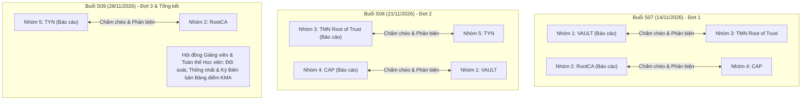
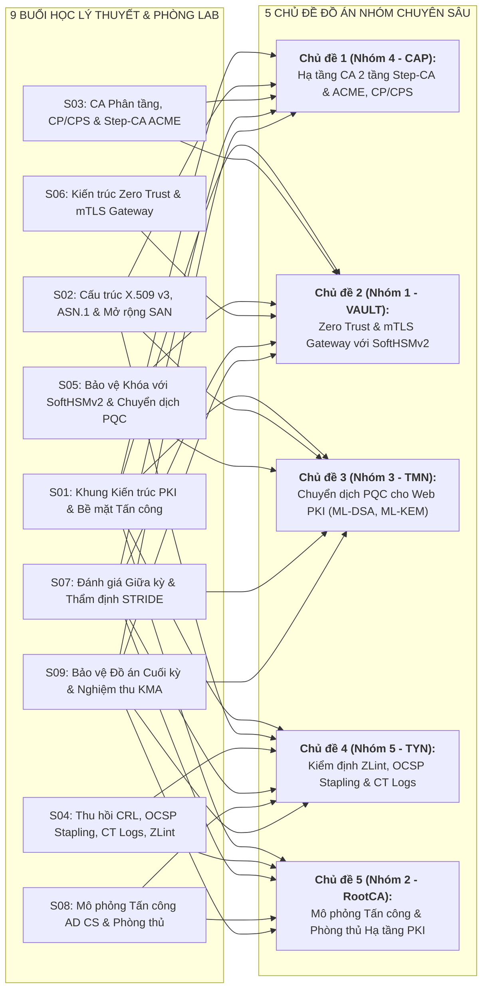

# BẢNG ĐIỀU PHỐI HỌC PHẦN CƠ SỞ HẠ TẦNG KHÓA CÔNG KHAI (PKI)
**Mã học phần:** ATHK 512 · **Lớp:** CHAT4P (Chất lượng cao An toàn thông tin) · **Học kỳ:** HK1, Năm học 2026–2027  
**Đơn vị:** Phân hiệu Học viện Kỹ thuật Mật mã tại TP. Hồ Chí Minh  
**Thời gian:** 13h30 Thứ Bảy hàng tuần (Khởi động: 03/10/2026) · **Địa điểm:** Phòng 201/202/203, Cơ sở Nam Thành phố

---

## 1. THÔNG SỐ VẬN HÀNH HỌC PHẦN

| Chỉ số | Giá trị | Ghi chú vận hành |
| :--- | :--- | :--- |
| **Tổng số buổi học** | 9 buổi (5 giờ/buổi) | 1 buổi định hướng, 5 buổi lý thuyết kết hợp Lab, 3 buổi bảo vệ đồ án nhóm |
| **Số bài thực hành Lab** | 5 bài chuyên sâu | OpenSSL 3.5, Step-CA, SoftHSMv2, Envoy mTLS, PQC (FIPS 203/204/205) |
| **Đồ án chuyên đề nhóm** | 5 nhóm chính thức | 5 nhóm kỹ thuật chuẩn hóa (3 học viên/nhóm), bảo vệ trực tiếp và chấm chéo |
| **Cơ cấu điểm thi KMA** | QT 30% / KTHP 70% | Công thức: TP1 (70% QT), TP2 (30% QT), KTHP (70% HP), DHP = ROUND(QT*0.3 + KTHP*0.7, 1) |
| **Quy mô lớp học chính thức** | **15 học viên** | Đúng 15 học viên tham gia học tập (2 học viên khác trong danh sách gốc được miễn môn học này) |

---

## 2. ĐỘI NGŨ ĐIỀU PHỐI & LIÊN LẠC

- **Giảng viên phụ trách học phần:** Nguyễn An Khương
  - *Đơn vị:* Khoa Khoa học & Kỹ thuật Máy tính, Trường ĐHBK Tp. HCM
  - *Email công vụ:* nakhuong@hcmut.edu.vn
- **Trợ giảng học phần (Teaching Assistant - TA):** Mr. Nguyễn Hữu Hoàng Huy
  - *Hồ sơ chuyên môn:* Cựu học viên lớp CHAT3P, KMA TP.HCM ([LinkedIn Profile](https://www.linkedin.com/in/nguyen-huu-hoang-huy-abb138366/))
  - *Nhiệm vụ:* Điều phối hạ tầng Docker, hỗ trợ kỹ thuật OpenSSL 3.5 / Step-CA / SoftHSM, kiểm tra Pull Request và phúc khảo bài Lab.
- **Lớp trưởng Lớp CHAT4P:** Học viên Tăng Triển Nguyên (Nhóm 3)
  - *Email liên hệ:* Lớp CHAT4P (GitHub: @AlexNguyen19)
  - *Nhiệm vụ:* Đầu mối thông báo lớp, tổng hợp danh sách nhóm chuyên đề và tiếp nhận kiến nghị học vụ.

---

## 3. MÔ HÌNH VẬN HÀNH: LỚP HỌC ĐẢO NGƯỢC (FLIPPED CLASSROOM & LAB-FIRST)

Học phần áp dụng phương thức đào tạo sau đại học tiên tiến nhằm tối đa hóa năng lực thực chiến của học viên:

1. **Giai đoạn Tiền buổi học (Pre-session):**
   - Trước mỗi buổi học tối thiểu 3 ngày, Ban giảng dạy phát hành toàn bộ Slide bài giảng, Handout tóm tắt lý thuyết, Lecture Notes và đề bài Lab lên Evidence Repository.
   - Học viên có trách nhiệm đọc trước tài liệu, chuẩn bị môi trường Docker và hoàn thành các câu hỏi trinh sát (Reconnaissance Questions).
2. **Giai đoạn Tại lớp (In-session - 5 giờ):**
   - **45–60 phút đầu:** Giảng viên tóm lược các nguyên lý mật mã lõi, phân tích lỗi thiết kế hệ thống thực tế và giải đáp các vấn đề học viên gặp phải khi đọc trước.
   - **180–200 phút tiếp theo:** Toàn bộ lớp học chuyển sang chế độ Lab thực chiến. Giảng viên và Trợ giảng trực tiếp quan sát, hỗ trợ giải quyết xung đột cấu hình và kiểm tra cơ chế phòng vệ của học viên.
   - **30–45 phút cuối:** Phân tích ca điển hình (Debriefing), công bố kết quả nghiệm thu tại lớp và giao nhiệm vụ buổi tiếp theo.
3. **Giai đoạn Hậu buổi học (Post-session):**
   - Học viên đẩy mã nguồn và báo cáo kết quả lên repository cá nhân dưới dạng Pull Request.
   - Hệ thống tự động kiểm thử và đối soát kết quả trước hạn chót.

---

## 4. LỘ TRÌNH CHI TIẾT 9 BUỔI HỌC

| Buổi | Ngày | Chủ đề Bài giảng | Trọng tâm Thực hành Lab | Tiêu chuẩn & Công cụ | Trạng thái |
| :---: | :---: | :--- | :--- | :--- | :---: |
| **S01** | 03/10 | Khung kiến trúc PKI & An toàn hệ thống tin cậy | Lab 0: Onboarding, Git/Docker, Thiết lập Evidence Repo & Giao nhiệm vụ 5 nhóm | QĐ 1875/QĐ-TTg, RFC 5280, Docker | Sẵn sàng |
| **S02** | 10/10 | X.509, Cấu trúc ASN.1 & Chuỗi tin cậy | Lab 1: Mổ xẻ ASN.1, Khai thác lỗ hổng chuỗi & Nghiệm thu ZLint | RFC 5280, OpenSSL 3.5, dumpasn1, ZLint | Kế hoạch |
| **S03** | 17/10 | Quản trị CA & Vòng đời chứng thư số | Lab 2: Thiết kế CA 2 tầng (Root/Sub), Cấp phát tự động ACME | RFC 3647 (CP/CPS), RFC 8555 (ACME), step-ca | Kế hoạch |
| **S04** | 24/10 | Thu hồi chứng thư & Quản lý khóa với HSM | Lab 3: Thu hồi CRL/OCSP Stapling, Bảo vệ khóa ký bằng SoftHSMv2 | RFC 6960 (OCSP), PKCS#11, SoftHSMv2 | Kế hoạch |
| **S05** | 31/10 | Giao thức an toàn: TLS 1.3 & mTLS Gateway | Lab 4: Kiến trúc mTLS Gateway bảo vệ Microservices & SPIFFE/SPIRE | RFC 8446 (TLS 1.3), Envoy Proxy, Nginx | Kế hoạch |
| **S06** | 07/11 | Mật mã Hậu lượng tử (PQC) & Lộ trình chuyển dịch | Lab 5: Benchmark hiệu năng chuỗi chứng thư ML-DSA & ML-KEM | NIST FIPS 203/204/205, RFC 9881, OpenSSL 3.5 PQC | Kế hoạch |
| **S07** | 14/11 | Bảo vệ Đồ án Chuyên đề Nhóm (Đợt 1) | Thuyết trình & Live Demo: **Nhóm 1 (VAULT)** & **Nhóm 2 (RootCA)** | Phản biện: Nhóm 3 (TMN) & Nhóm 4 (CAP) | Kế hoạch |
| **S08** | 21/11 | Bảo vệ Đồ án Chuyên đề Nhóm (Đợt 2) | Thuyết trình & Live Demo: **Nhóm 3 (TMN)** & **Nhóm 4 (CAP)** | Phản biện: Nhóm 5 (TYN) & Nhóm 1 (VAULT) | Kế hoạch |
| **S09** | 28/11 | Bảo vệ Đồ án (Đợt 3) & Đối soát Điểm tổng kết | Thuyết trình: **Nhóm 5 (TYN)** (Nhóm 2 phản biện) & Đối soát bảng điểm | Toàn thể lớp đối soát và ký biên bản KMA | Kế hoạch |

---

## 5. DANH SÁCH 5 NHÓM KỸ THUẬT CHÍNH THỨC (CHUẨN HÓA 15 HỌC VIÊN)

Dữ liệu chính thức từ tệp [`DS_Nhom_CHAT_4P_PKI.xlsx`](file:///Users/nakhuong/Library/CloudStorage/GoogleDrive-nakhuong@gmail.com/My%20Drive/0-TEACHING%20and%20GUIDING/KMA/PKI/HK261%20%28CHAT4P%29/DS_Nhom_CHAT_4P_PKI.xlsx):

| Nhóm | Tên Nhóm | Trưởng nhóm | Thành viên nhóm | Ngành | Đơn vị công tác & Lĩnh vực | Buổi bảo vệ |
| :---: | :---: | :--- | :--- | :---: | :--- | :---: |
| **Nhóm 1** | **VAULT** | **Nguyễn Ngọc Hoài** | Nguyễn Trần Hoàng Long Nguyễn Đình Quân | ATTT ATTT ATTT | `@hoainn` `@JackkNguyen1209` `@DiWien` | **Buổi S07** (14/11) |
| **Nhóm 2** | **RootCA** | **Nguyễn Vĩnh Hiển** | Nguyễn Ngọc Sơn Nguyễn Trường Phú | CNTT CNTT CNTT | `@jerryhien` `@sonnn` `@crazykid95` | **Buổi S07** (14/11) |
| **Nhóm 3** | **TMN** | **Võ Thông Minh** | Tăng Triển Nguyên Trần Minh Triết | ATTT CNTT ATTT | `@ngayhomay` `@AlexNguyen19` `@chuoihat` | **Buổi S08** (21/11) |
| **Nhóm 4** | **CAP** | **Vũ Thị Diệu Anh** | Diệp Kim Chi Đoàn Quang Phúc | CNTT CNTT Tin học UD | `@dieuanh1511` `@chidiep2312` `@medvedru777` | **Buổi S08** (21/11) |
| **Nhóm 5** | **TYN** | **Võ Minh Nhật** | Hồ Quốc Thái Nguyễn Công Ý | CNTT CNTT CNTT | `@vominhat` `@thaisonnam` `@nguyencongy` | **Buổi S09** (28/11) |

> [!NOTE]
> **Học viên được miễn học phần này:**  
> 1. **Nguyễn Tuấn Anh** (CHAT4P002)  
> 2. **Huỳnh Trần Trọng Nghĩa** (CHAT4P011)  
> *Hai học viên này được miễn học phần ATHK 512 theo quy định đào tạo sau đại học của Học viện Kỹ thuật Mật mã, không tính vào sĩ số thực học (15 HV).*

---

## 6. MA TRẬN BẢO VỆ & CHẤM CHÉO ĐỐI KHÁNG TẠI CÁC BUỔI S07, S08, S09

- **Nguyên tắc chấm chéo:** Nhóm phản biện đặt tối thiểu 3 câu hỏi kỹ thuật chuyên sâu về kiến trúc, kiểm thử tải hoặc mô hình đe dọa, sau đó cho điểm vào Phiếu chấm chéo. Điểm chấm chéo đóng góp 15% tổng điểm KTHP của nhóm được chấm.
- Điểm chấm chéo có độ lệch lớn hơn 2.0 điểm so với điểm trung bình của Hội đồng Giảng viên sẽ được Hội đồng xem xét và thẩm định lại.

---

## 7. QUY CHẾ ĐÁNH GIÁ & CÔNG THỨC TÍNH ĐIỂM KMA CHUẨN

Cơ cấu điểm số tuân thủ nghiêm ngặt định dạng của Ban Khảo thí & Đảm bảo chất lượng đào tạo (tệp `Bang diem lop CHAT4P.xlsx`):

- **Điểm Học phần (Cột Q - DHP):** `ROUND(DQT*0.3 + KTHP*0.7, 1)`
- **Điểm Quá trình (Cột G & O - DQT):** `ROUND(TP1*0.7 + TP2*0.3, 1)`
- **Điểm Thành phần 1 (Cột E - TP1, trọng số 70% Điểm Quá trình = 21% Điểm Học phần):** Điểm trung bình cộng của 5 bài thực hành Lab cá nhân (S02 đến S06).
- **Điểm Thành phần 2 (Cột F - TP2, trọng số 30% Điểm Quá trình = 9% Điểm Học phần):** Đánh giá mức độ chuyên cần tham gia đủ 9 buổi học tại giảng đường (kết hợp dữ liệu điểm danh thực tế và kết quả các bài Mini-Quiz đầu giờ).
- **Điểm Thi Kết thúc Học phần (Cột P - KTHP, trọng số 70% Điểm Học phần):** Đồ án Chuyên đề Kỹ thuật theo nhóm, bảo vệ trực tiếp tại hội đồng trong các buổi S07, S08, S09:
  - Mã nguồn & Demo hệ thống: 35%
  - Báo cáo Kỹ thuật Chuyên đề: 25%
  - Bảo vệ & Phản biện trực tiếp: 25%
  - Đánh giá Chấm chéo giữa các nhóm: 15%

---

## 8. BỘ CÔNG CỤ ĐIỀU HÀNH HỌC THUẬT DÀNH CHO GIẢNG VIÊN (CLI TOOLCHAIN)

- `bash PKI.sh cong`: Kiểm tra chất lượng học liệu (Session Gate S01–S09).
- `bash PKI.sh giong`: Kiểm tra phong cách học thuật (Voice Check), loại bỏ từ ngữ cấm và xưng hô không chuẩn.
- `bash PKI.sh scrub`: Quét bảo mật và ngăn ngừa rò rỉ khóa bí mật ra môi trường chia sẻ.
- `bash PKI.sh diem`: Mở giao diện nhập và đồng bộ bảng điểm lớp học `Bang diem lop CHAT4P.xlsx`.
- `bash PKI.sh biendich`: Biên dịch đồng bộ toàn bộ học liệu ra mọi định dạng (.md, .docx, .html, .pdf, .xlsx).

---

## 4. MA TRẬN ÁNH XẠ GIỮA 9 BUỔI HỌC VÀ 5 CHỦ ĐỀ ĐỒ ÁN (MAPPING INFOGRAPHIC)

Để học viên hình dung rõ ràng lộ trình học tập, từng buổi học lý thuyết và thực hành đều được thiết kế để trực tiếp cung cấp khối kiến thức và thành phần công nghệ cho 5 đề tài đồ án chuyên sâu:

### Bảng Phân Tích Ma Trận Kế Thừa Tri Thức:

| Buổi học | Nội dung Trọng tâm Buổi học | Đóng góp Trực tiếp cho 5 Chủ đề Đồ án Nhóm |
|:---:|---|---|
| **S01** | Bối cảnh thể chế (QĐ 1875), 3 mô hình PKI, nguyên tắc Root CA offline | **Cả 5 Nhóm:** Nền tảng thiết kế kiến trúc phân tầng, xác định ranh giới niềm tin và bề mặt tấn công. |
| **S02** | Giải phẫu ASN.1 DER, Basic Constraints, Key Usage, SAN | **Nhóm 1, 3, 4, 5:** Cấu hình chính xác tệp mở rộng OpenSSL, tạo chứng chỉ máy chủ có SAN, kiểm soát cờ CA. |
| **S03** | Khởi tạo CA 2 tầng, CP/CPS RFC 3647, Step-CA & ACME RFC 8555 | **Nhóm 4 (Trọng tâm) & Nhóm 1:** Xây dựng máy chủ Step-CA ACME tự động hóa; hoàn thiện bộ quy chế CP/CPS 9 mục. |
| **S04** | Thu hồi CRL v2, OCSP Responder, OCSP Stapling, CT Logs, ZLint | **Nhóm 5 (Trọng tâm) & Nhóm 2:** Triển khai OCSP Responder thời gian thực, tích hợp linter ZLint vào CI/CD. |
| **S05** | Cryptoki API PKCS#11, Token SoftHSMv2, Bộ chuẩn PQC NIST (FIPS 203/204) | **Nhóm 3 (Trọng tâm) & Nhóm 1:** Nhóm 3 làm chủ OpenSSL 3.5 + liboqs; Nhóm 1 tích hợp SoftHSMv2 lưu khóa CA. |
| **S06** | Zero Trust (NIST SP 800-207), mTLS 2 chiều, định danh SPIFFE/SPIRE, Envoy Gateway | **Nhóm 1 (Trọng tâm):** Dựng cổng mTLS Gateway xác thực danh tính client dựa trên SAN URI SPIFFE ID. |
| **S07** | Đánh giá tiến độ giữa kỳ, mô hình đe dọa STRIDE, chấm chéo ngang hàng | **Cả 5 Nhóm:** Thẩm định thiết kế kỹ thuật, rà soát mô hình STRIDE và hoàn thành 50% khối lượng mã nguồn. |
| **S08** | Khai thác lỗ hổng cấu hình AD CS (ESC1/ESC8), Rogue CA, Phòng thủ đa tầng | **Nhóm 2 (Trọng tâm) & Nhóm 5:** Mô phỏng chuỗi tấn công chiếm quyền quản trị và xây dựng bộ lọc phòng ngự. |
| **S09** | Demo hệ thống trực tiếp trên Docker, vấn đáp chuyên sâu, đối soát bảng điểm KMA | **Cả 5 Nhóm:** Báo cáo tổng kết đồ án, bàn giao mã nguồn hoàn chỉnh và nghiệm thu kết quả học tập. |
