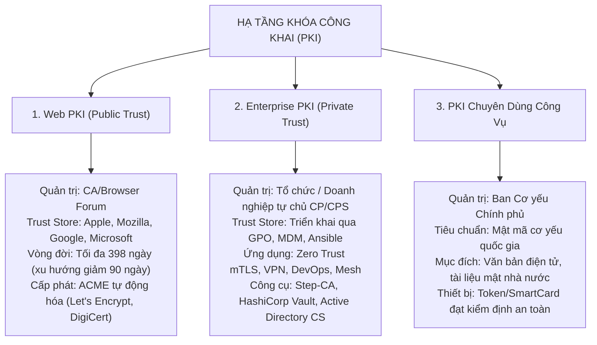
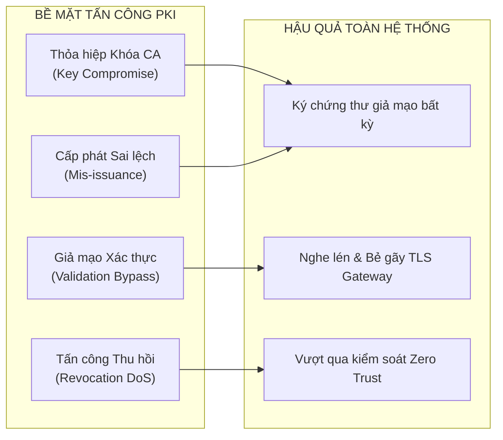

# Handout S01: Khung Kiến trúc PKI & An toàn Hệ thống Tin cậy

**Học phần:** Cơ sở hạ tầng khóa công khai (ATHK 512) · Lớp CHAT4P  
**Đơn vị:** Khoa An toàn Thông tin — Phân hiệu Học viện Kỹ thuật Mật mã tại TP.HCM  
**Giảng viên:** Nguyễn An Khương (Khoa Khoa học & Kỹ thuật Máy tính, Trường ĐHBK Tp. HCM)  
**Trợ giảng:** Nguyễn Hữu Hoàng Huy  

---

## 1. Bối cảnh Thể chế & Cơ sở Pháp lý Quốc gia

Hạ tầng khóa công khai (PKI) đóng vai trò là nền tảng xác thực định danh và bảo đảm tính toàn vẹn cho không gian số quốc gia:

1. **Quyết định 1875/QĐ-TTg (Khung kiến trúc an ninh mạng quốc gia):**
   * **Điều 2, Khoản 3:** Xác định trách nhiệm của Ban Cơ yếu Chính phủ trong việc ban hành tiêu chuẩn mật mã cơ yếu, quy chuẩn kỹ thuật chứng thực chữ ký số chuyên dùng công vụ.
   * **Quản lý Vòng đời Khóa:** Khẳng định quản trị khóa và chứng thư số là thành phần bảo vệ trọng yếu trước các nguy cơ tấn công chuỗi cung ứng và giả mạo định danh cấp nhà nước.
2. **Luật Giao dịch Điện tử năm 2023 (Hiệu lực 01/07/2024):**
   * Quy định phân định rõ ràng giữa Chữ ký số công cộng (Public PKI) và Chữ ký số chuyên dùng công vụ (Government PKI).
   * Giá trị pháp lý của thông điệp dữ liệu ký số phụ thuộc tuyệt đối vào độ tin cậy của chuỗi chứng thư điện tử xác thực người ký.

---

## 2. Phân loại 3 Mô hình PKI Thực tế

---

## 3. Bề mặt Tấn công & Chuỗi Phân rã Tin cậy (Trust Decomposition)

Một hệ thống PKI bị phá vỡ khi một trong các mắt xích sau đây bị tổn thương:

---

## 4. Ba Nguyên tắc Thiết kế Bất biến

* **Nguyên tắc 1: Phân tách Miền tin cậy (Air-gapped Root Isolation):** Root CA luôn được lưu trữ ngoại tuyến (offline), ngắt kết nối mạng vật lý. Mọi hoạt động phát hành chứng thư cho thực thể đầu cuối đều phải ủy quyền cho Intermediate CA.
* **Nguyên tắc 2: Tự động hóa Vòng đời (Automated Lifecycle Management):** Áp dụng chứng chỉ thời hạn ngắn (short-lived) kết hợp giao thức ACME để loại bỏ sai sót thủ công và giảm thiểu cửa sổ lộ khóa.
* **Nguyên tắc 3: Sẵn sàng Chuyển dịch Hậu lượng tử (Crypto-Agility & PQC Readiness):** Kiến trúc hệ thống phải hỗ trợ thay thế linh hoạt thuật toán sang ML-DSA (FIPS 204) và ML-KEM (FIPS 203) mà không cần viết lại toàn bộ hạ tầng.

---

## 5. Tài liệu Tham khảo Chuẩn Quốc tế

1. **Thủ tướng Chính phủ:** *Quyết định số 1875/QĐ-TTg về Phê duyệt Khung kiến trúc an ninh mạng quốc gia*, Hà Nội, 2023.
2. **IETF RFC 5280:** *Internet X.509 Public Key Infrastructure Certificate and Certificate Revocation List (CRL) Profile*, RFC Editor, 2008. [rfc-editor.org/rfc/rfc5280](https://www.rfc-editor.org/rfc/rfc5280)
3. **NIST SP 800-57 Part 1 Rev. 5:** *Recommendation for Key Management: General*, National Institute of Standards and Technology, 2020. [doi.org/10.6028/NIST.SP.800-57pt1r5](https://doi.org/10.6028/NIST.SP.800-57pt1r5)
4. **CA/Browser Forum:** *Baseline Requirements for the Issuance and Management of Publicly-Trusted Certificates*, Version 2.0.8, 2024. [cabforum.org](https://cabforum.org)
