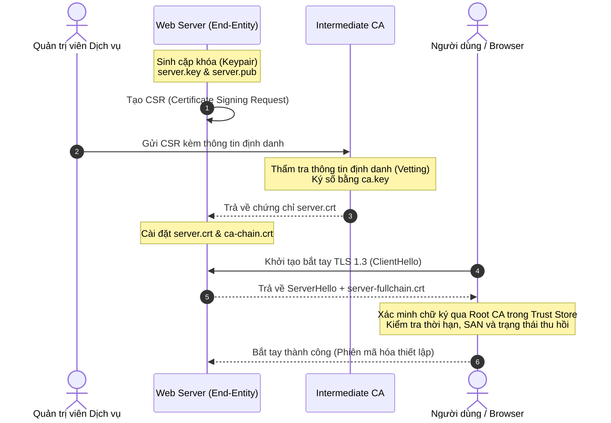

# Lecture Notes S01: Khung Kiến trúc PKI & An toàn Hệ thống Tin cậy

**Học phần:** Cơ sở hạ tầng khóa công khai (ATHK 512) · Lớp CHAT4P  
**Giảng viên:** Nguyễn An Khương (Khoa Khoa học & Kỹ thuật Máy tính, Trường ĐHBK Tp. HCM)  
**Trợ giảng:** Nguyễn Hữu Hoàng Huy  

---

## 1. Tổng quan Khung Kiến trúc PKI

Hạ tầng Khóa Công khai không đơn thuần là các tệp chứng thư số đuôi `.crt` hoặc `.pem`. Đây là một hệ thống tích hợp đa tầng bao gồm:
* **Hạ tầng Công nghệ (Technology):** Các thuật toán mật mã bất đối xứng (RSA, ECC, ML-DSA), giao thức truyền thông an toàn (TLS 1.3, ACME, OCSP), phần cứng bảo mật (HSM, SmartCard).
* **Quy chế & Chính sách (Policy & Governance):** Hệ thống văn bản CP (Certificate Policy) và CPS (Certification Practice Statement) quy định trách nhiệm pháp lý và thủ tục vận hành.
* **Quy trình Con người (Procedures):** Lễ sinh khóa (Key Ceremony), kiểm tra nhân thân (Identity Vetting), quy trình thu hồi khẩn cấp khi xảy ra sự cố an toàn thông tin.

---

## 2. Luồng Cấp phát và Xác thực Chứng thư X.509

---

## 3. Khác biệt Cốt lõi giữa Web PKI và Private Enterprise PKI

| Tiêu chí So sánh | Web PKI (Công cộng) | Enterprise PKI (Nội bộ Doanh nghiệp) |
|---|---|---|
| **Cơ quan Giám sát** | CA/Browser Forum, Trust Store Vendors | Ban Giám đốc An toàn Thông tin (CISO) |
| **Trust Store** | Tích hợp sẵn trong hệ điều hành và trình duyệt | Cài đặt tùy biến trên thiết bị nội bộ qua MDM/Active Directory |
| **Định danh Hỗ trợ** | Tên miền Internet FQDN (ví dụ: `kma.edu.vn`) | Tên miền nội bộ, IP riêng, Service Account, SPIFFE ID |
| **Chi phí Vận hành** | Miễn phí (Let's Encrypt) hoặc trả phí thương mại | Chi phí hạ tầng HSM, phần mềm CA và nhân lực quản trị |
| **Tính linh hoạt** | Nghiêm ngặt, cấm các trường mở rộng phi chuẩn | Tự do cấu hình mở rộng phù hợp nhu cầu nghiệp vụ |

---

## 4. Bài học Lịch sử: Sự cố Thỏa hiệp CA trên Thế giới

Học viên cần nghiên cứu hai sự cố tiêu biểu đã định hình lại lịch sử bảo mật PKI hiện đại:
1. **Sự cố DigiNotar (2011):** CA của Hà Lan bị xâm nhập, kẻ tấn công phát hành chứng chỉ giả mạo cho `*.google.com`, cho phép chặn bắt và đọc lén lưu lượng hàng triệu người dùng tại Iran. Kết quả: DigiNotar bị trục xuất hoàn toàn khỏi tất cả Trust Store và phá sản sau vài tuần. Sự cố này trực tiếp dẫn tới sự ra đời của **Certificate Transparency (RFC 6962)**.
2. **Sự cố Symantec CA (2015–2017):** Phát hành sai lệch hàng nghìn chứng chỉ thử nghiệm mà không có sự đồng ý của chủ tên miền. Google Chrome và Mozilla đã quyết định thu hồi niềm tin toàn diện đối với toàn bộ chuỗi chứng chỉ của Symantec, buộc mảng kinh doanh CA này phải bán lại cho DigiCert.

---

## 5. Tài liệu Tham khảo Mở rộng

1. **RFC 5280:** *X.509 PKI and CRL Profile*. [rfc-editor.org/rfc/rfc5280](https://www.rfc-editor.org/rfc/rfc5280)
2. **Ross Anderson:** *Security Engineering: A Guide to Building Dependable Distributed Systems*, 3rd Edition, Wiley, 2020. (Chương 21: Public Key Infrastructure).
3. **Niels Ferguson, Bruce Schneier, Tadayoshi Kohno:** *Cryptography Engineering: Design Principles and Practical Applications*, Wiley, 2010.
