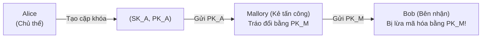
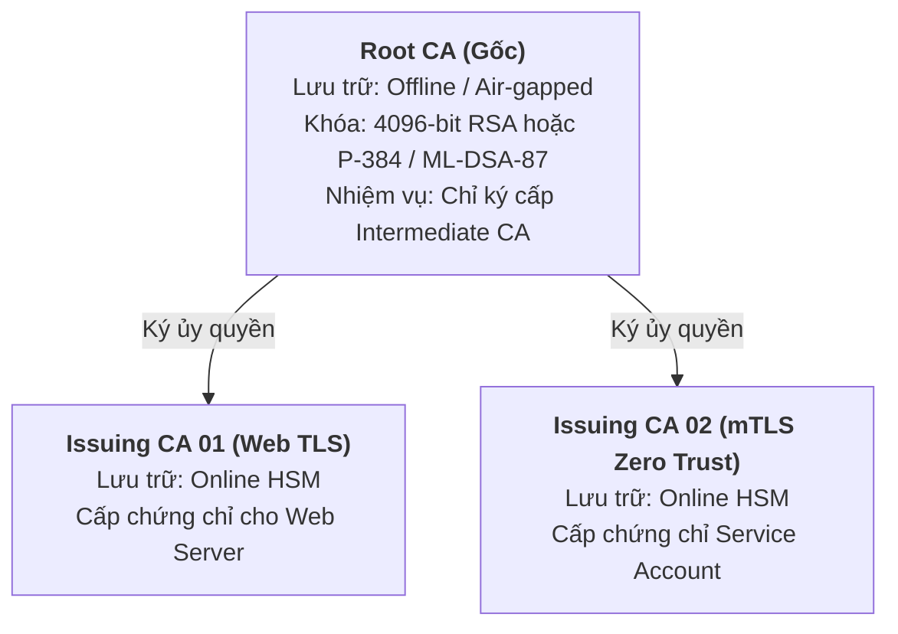

# Slides S01: Khung Kiến trúc PKI & An toàn Hệ thống Tin cậy

**Học phần:** Cơ sở hạ tầng khóa công khai (ATHK 512) · Lớp CHAT4P  
**Giảng viên:** Nguyễn An Khương (Khoa Khoa học & Kỹ thuật Máy tính, Trường ĐHBK Tp. HCM · [ORCID: 0000-0002-9910-6387](https://orcid.org/0000-0002-9910-6387))  
**Trợ giảng:** Nguyễn Hữu Hoàng Huy  

---

## Slide 1: Chào mừng đến với Học phần PKI & PQC

* **Mã môn học:** ATHK 512 (2 tín chỉ lý thuyết + thực hành phòng lab)
* **Đối tượng:** Học viên Cao học An toàn Thông tin (Khóa 4P - Phân hiệu TP.HCM)
* **Triết lý đào tạo:** *Systems Cryptographic Engineering & Lab-First*
* **Mục tiêu kép:** Làm chủ hạ tầng PKI hiện đại và sẵn sàng cho kỷ nguyên hậu lượng tử (PQC).

---

## Slide 2: Vấn đề Cốt lõi của Mật mã Bất đối xứng

Làm thế nào Bob biết chắc chắn rằng khóa công khai $PK_A$ thực sự thuộc về Alice, chứ không phải của kẻ tấn công Mallory đang đứng ở giữa?

**Giải pháp:** Cần một bên thứ ba đáng tin cậy (Trusted Third Party - CA) chứng thực mối liên kết giữa danh tính của Alice và khóa công khai $PK_A$.

---

## Slide 3: Kiến trúc Phân tầng 2 Cấp (Two-tier CA Hierarchy)

---

## Slide 4: Yêu cầu Nghiên cứu Chuẩn mực

Mỗi học viên cần nắm vững các văn bản tiêu chuẩn sau trong suốt học phần:
* **IETF RFC 5280:** Tiêu chuẩn nền tảng về cấu trúc chứng thư X.509 v3 và CRL v2.
* **IETF RFC 8555:** Giao thức quản lý và tự động hóa cấp chứng thư ACME.
* **IETF RFC 6962:** Cơ chế minh bạch hóa chứng chỉ Certificate Transparency.
* **NIST FIPS 203 & 204:** Chuẩn mật mã hậu lượng tử ML-KEM và ML-DSA.
