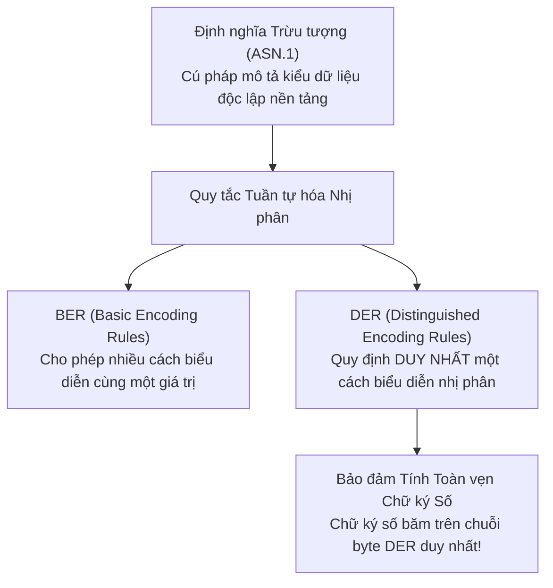
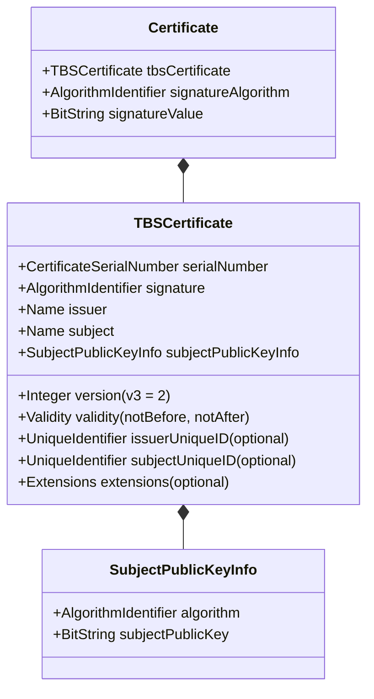

# Handout S02: Cấu trúc Dữ liệu X.509 v3 & Mã hóa Nhị phân ASN.1

**Học phần:** Cơ sở hạ tầng khóa công khai (ATHK 512) · Lớp CHAT4P  
**Giảng viên:** Nguyễn An Khương (Khoa Khoa học & Kỹ thuật Máy tính, Trường ĐHBK Tp. HCM · [ORCID: 0000-0002-9910-6387](https://orcid.org/0000-0002-9910-6387))  
**Trợ giảng:** Nguyễn Hữu Hoàng Huy  

---

## 1. Ngôn ngữ Trừu tượng ASN.1 và Quy tắc Mã hóa DER

Cấu trúc chứng chỉ X.509 được định nghĩa bằng ngôn ngữ biểu diễn dữ liệu trừu tượng **ASN.1 (Abstract Syntax Notation One)**. Để lưu trữ trên đĩa hoặc truyền qua mạng, cấu trúc này bắt buộc phải được tuần tự hóa nhị phân theo chuẩn **DER (Distinguished Encoding Rules)**:

---

## 2. Cấu trúc Cây Dữ liệu Phân tầng của Chứng chỉ X.509 v3

Một chứng thư số X.509 v3 bao gồm 3 khối dữ liệu chính theo định nghĩa RFC 5280:

---

## 3. Các Phần Mở rộng Trọng yếu (Critical Certificate Extensions)

Khi một phần mở rộng được đánh dấu cờ `critical = TRUE`, bên xác thực bắt buộc phải hiểu và áp dụng chính xác ràng buộc đó; nếu không hiểu, bắt buộc phải từ chối chứng chỉ:

| Tên Mở rộng | OID Chuẩn | Cờ Critical | Mục đích Kỹ thuật & Rủi ro nếu Cấu hình Sai |
|---|---|:---:|---|
| **Basic Constraints** | `2.5.29.19` | **BẮT BUỘC** | Xác định chứng chỉ có phải là CA hay không (`CA:TRUE/FALSE`) và độ sâu nhánh (`pathlen`). Nếu thiếu, kẻ tấn công có thể dùng chứng chỉ máy chủ để ký chứng chỉ giả mạo khác! |
| **Key Usage** | `2.5.29.15` | **BẮT BUỘC** | Giới hạn mục đích sử dụng của khóa (ví dụ: `keyCertSign`, `cRLSign`, `digitalSignature`, `keyEncipherment`). |
| **Extended Key Usage (EKU)** | `2.5.29.37` | Tùy chọn | Ràng buộc nghiệp vụ tầng ứng dụng: `serverAuth` (máy chủ TLS), `clientAuth` (mTLS), `codeSigning` (ký mã nguồn). |
| **Subject Alternative Name (SAN)** | `2.5.29.17` | Khuyến nghị | Danh sách định danh hợp lệ: DNS Name, IP Address, URI (SPIFFE ID). Trình duyệt hiện đại đã loại bỏ hoàn toàn việc kiểm tra Common Name (CN). |
| **Name Constraints** | `2.5.29.30` | Tùy chọn | Giới hạn không gian tên miền con mà Intermediate CA được phép phát hành (ví dụ: chỉ được cấp chứng thư cho đuôi `.kma.edu.vn`). |

---

## 4. Tài liệu Tham khảo Chuẩn Quốc tế

1. **ITU-T Recommendation X.680 | ISO/IEC 8824-1:** *Abstract Syntax Notation One (ASN.1): Specification of basic notation*, Geneva, 2021.
2. **ITU-T Recommendation X.690 | ISO/IEC 8825-1:** *ASN.1 encoding rules: Specification of Basic Encoding Rules (BER), Canonical Encoding Rules (CER) and Distinguished Encoding Rules (DER)*, Geneva, 2021.
3. **IETF RFC 5280:** *Internet X.509 Public Key Infrastructure Certificate and CRL Profile (§4.2: Certificate Extensions)*, 2008. [rfc-editor.org/rfc/rfc5280](https://www.rfc-editor.org/rfc/rfc5280)
4. **Peter Gutmann:** *X.509 Style Guide*, University of Auckland, 2000.
