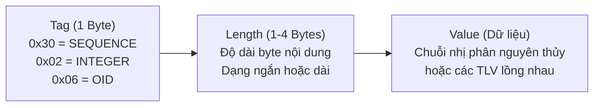

# Slides S02: Cấu trúc Dữ liệu X.509 v3, Mở rộng ASN.1 & Phân tích Nhị phân

**Học phần:** Cơ sở hạ tầng khóa công khai (ATHK 512) · Lớp CHAT4P  
**Giảng viên:** Nguyễn An Khương (Khoa Khoa học & Kỹ thuật Máy tính, Trường ĐHBK Tp. HCM)  
**Trợ giảng:** Nguyễn Hữu Hoàng Huy  

---

## Slide 1: Từ Khái niệm Trừu tượng đến Dòng Byte Nhị phân

* Bài toán: Làm thế nào để các hệ thống khác nhau (Linux, Windows, Router, IoT) hiểu thống nhất cùng một cấu trúc chứng chỉ?
* **ASN.1:** Ngôn ngữ đặc tả kiểu dữ liệu mức cao.
* **DER:** Quy tắc mã hóa nhị phân bất biến (Deterministic Encoding).
* Một byte sai khác trong cấu trúc DER sẽ làm hỏng chữ ký số toàn vẹn!

---

## Slide 2: Sơ đồ Mã hóa Tag - Length - Value (TLV)

---

## Slide 3: Phần Mở rộng Quyết định An toàn: Basic Constraints

* **Kịch bản Tấn công:** Nếu CA cấp chứng chỉ máy chủ cho Hacker mà quên không cấu hình `basicConstraints = critical, CA:FALSE`.
* **Hậu quả:** Kẻ tấn công có thể dùng chính khóa riêng tư của máy chủ đó để ký tạo ra các chứng chỉ giả mạo cho `google.com`, `bank.internal` mà trình duyệt vẫn chấp nhận là hợp lệ!
* **Nguyên tắc:** Mọi chứng chỉ End-Entity bắt buộc phải cấu hình `CA:FALSE` hoặc vắng mặt khả năng cấp phát.

---

## Slide 4: Subject Alternative Name (SAN) thay thế Common Name

* Trình duyệt hiện đại (Chrome từ v58, Firefox) đã bãi bỏ việc đọc Common Name (CN) trong Subject.
* Bắt buộc khai báo định danh trong phần mở rộng **Subject Alternative Name (SAN)**:
  * `DNS:api.kma.internal`
  * `DNS:*.kma.internal` (Wildcard)
  * `IP:192.168.1.100`
  * `URI:spiffe://kma.edu.vn/sa/payment`
