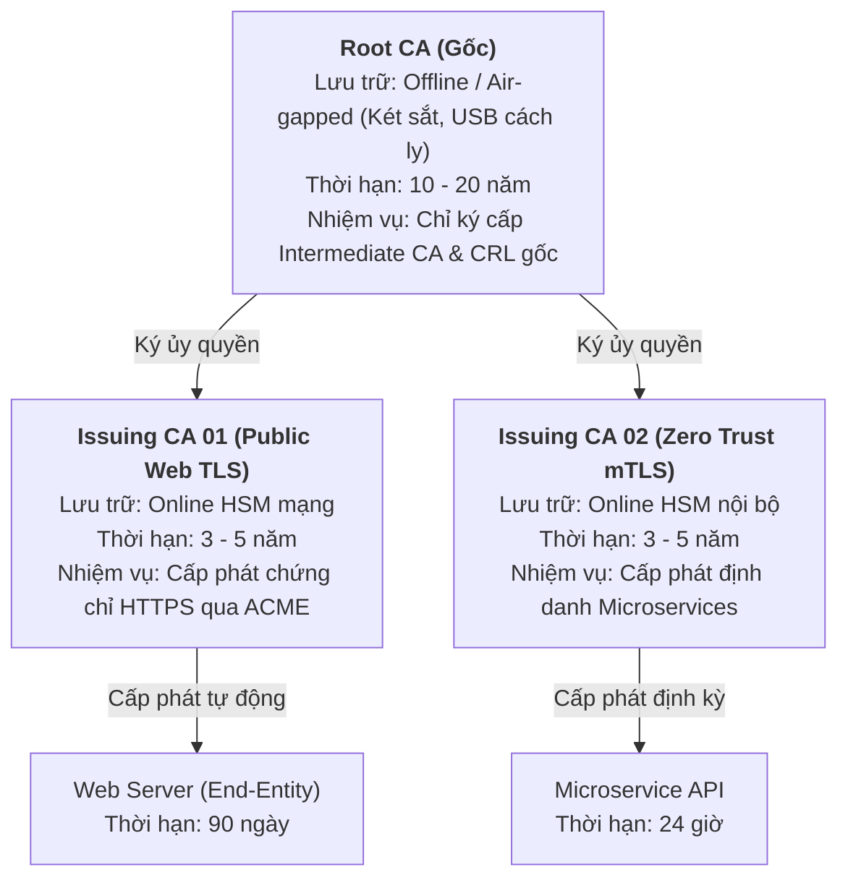
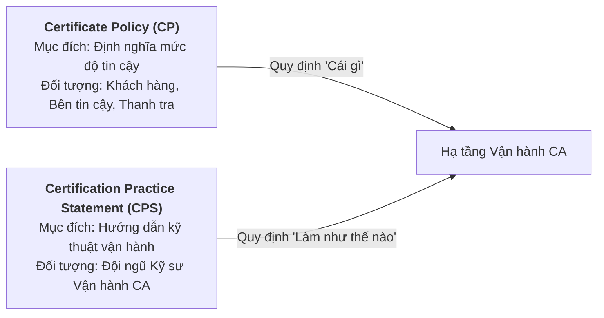
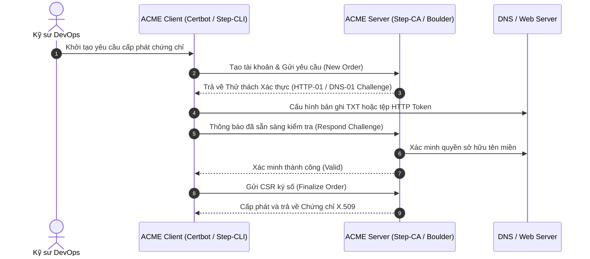

# Handout S03: Hạ tầng CA Phân tầng, Quy chế CP/CPS & Cấp phát Tự động ACME

**Học phần:** Cơ sở hạ tầng khóa công khai (ATHK 512) · Lớp CHAT4P  
**Đơn vị:** Khoa An toàn Thông tin — Phân hiệu Học viện Kỹ thuật Mật mã tại TP.HCM  
**Giảng viên:** Nguyễn An Khương (Khoa Khoa học & Kỹ thuật Máy tính, Trường ĐHBK Tp. HCM)  
**Trợ giảng:** Nguyễn Hữu Hoàng Huy  

---

## 1. Kiến trúc Phân tầng CA Đa cấp (Multi-tier CA Hierarchy)

Mô hình phân tầng bảo đảm phân tách rủi ro giữa việc duy trì gốc tin cậy lâu dài và hoạt động cấp phát thường nhật:

---

## 2. Quy chế CP/CPS theo Chuẩn IETF RFC 3647

Mọi hệ thống CA chuyên nghiệp bắt buộc phải vận hành dựa trên 2 bộ tài liệu pháp lý kỹ thuật:
1. **Certificate Policy (CP):** Bản tuyên ngôn quy định chứng chỉ được cấp cho ai, nhằm mục đích gì và mức độ tin cậy tương ứng.
2. **Certification Practice Statement (CPS):** Bản đặc tả chi tiết quy trình kỹ thuật vận hành để hiện thực hóa CP (cách sinh khóa, quy trình lưu trữ, nhân sự tham gia, biện pháp phục hồi thảm họa).

---

## 3. Giao thức Quản lý Chứng chỉ Tự động ACME (RFC 8555)

ACME (Automated Certificate Management Environment) giải quyết bài toán sai sót con người và chứng chỉ hết hạn bất ngờ:

---

## 4. Tài liệu Tham khảo Chuẩn Quốc tế

1. **IETF RFC 3647:** *Internet X.509 Public Key Infrastructure Certificate Policy and Certification Practices Framework*, RFC Editor, 2003. [rfc-editor.org/rfc/rfc3647](https://www.rfc-editor.org/rfc/rfc3647)
2. **IETF RFC 8555:** *Automatic Certificate Management Environment (ACME)*, RFC Editor, 2019. [rfc-editor.org/rfc/rfc8555](https://www.rfc-editor.org/rfc/rfc8555)
3. **Smallstep Labs:** *Production PKI Architecture and Practical Step-CA Deployments*, 2024. [smallstep.com/docs](https://smallstep.com/docs)
