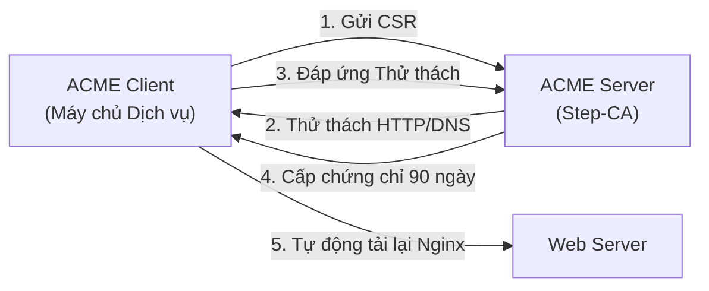

# Slides S03: Hạ tầng CA Phân tầng, Quy chế CP/CPS & Cấp phát Tự động ACME

**Học phần:** Cơ sở hạ tầng khóa công khai (ATHK 512) · Lớp CHAT4P  
**Giảng viên:** Nguyễn An Khương (Khoa Khoa học & Kỹ thuật Máy tính, Trường ĐHBK Tp. HCM · [ORCID: 0000-0002-9910-6387](https://orcid.org/0000-0002-9910-6387))  
**Trợ giảng:** Nguyễn Hữu Hoàng Huy  

---

## Slide 1: Tại sao Cần Phân tầng CA?

* Nếu chỉ dùng 1 Root CA duy nhất để cấp chứng chỉ cho mọi dịch vụ:
  * Khóa bí mật của Root CA phải để online liên tục trên máy chủ kết nối Internet.
  * Nếu máy chủ bị tấn công hoặc lộ khóa: **Toàn bộ hệ thống sụp đổ, phải thay thế chứng chỉ trên tất cả thiết bị!**
* **Nguyên tắc vàng:** Root CA ngắt mạng hoàn toàn; chỉ ký cấp cho Intermediate CA.

---

## Slide 2: Lễ Sinh Khóa Root CA (Key Ceremony)

Một sự kiện quản trị an toàn cấp cao nhất:
* Tiến hành trong phòng an ninh cách ly (Faraday cage / phòng sạch).
* Có sự chứng kiến của Ban kiểm toán, CISO và các chuyên viên nắm giữ mảnh khóa (Shamir's Secret Sharing).
* Khóa sinh trực tiếp bên trong thiết bị phần cứng chuyên dụng (HSM FIPS 140-2 Level 3+).
* Toàn bộ quá trình được ghi hình, niêm phong nhật ký và lưu trữ trong két sắt chống cháy.

---

## Slide 3: Tự động hóa Vòng đời với Giao thức ACME

---

## Slide 4: Chu kỳ Gia hạn Tự động (Automated Renewal)

* Chứng chỉ có thời hạn 90 ngày.
* Ngày thứ 60: Client tự động kích hoạt tiến trình gia hạn qua cronjob hoặc systemd timer.
* Nếu gia hạn thất bại: Hệ thống gửi cảnh báo về hệ thống giám sát SIEM/Slack để kỹ sư can thiệp trước 30 ngày.
