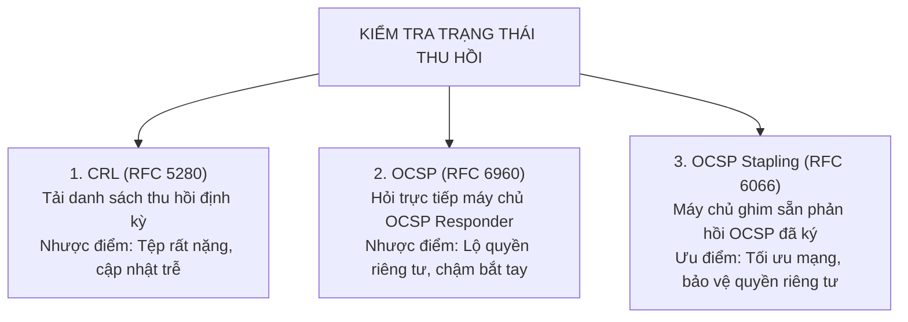
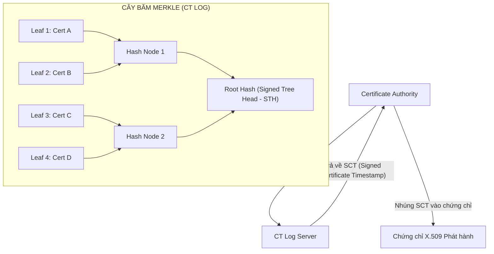

# Handout S04: Cơ chế Thu hồi Chứng chỉ: CRL, OCSP Stapling & Certificate Transparency

**Học phần:** Cơ sở hạ tầng khóa công khai (ATHK 512) · Lớp CHAT4P  
**Đơn vị:** Khoa An toàn Thông tin — Phân hiệu Học viện Kỹ thuật Mật mã tại TP.HCM  
**Giảng viên:** Nguyễn An Khương (Khoa Khoa học & Kỹ thuật Máy tính, Trường ĐHBK Tp. HCM)  
**Trợ giảng:** Nguyễn Hữu Hoàng Huy  

---

## 1. Nhu cầu Thu hồi Chứng chỉ Trước Thời hạn

Chứng chỉ số cần được thu hồi khẩn cấp khi:
* Khóa riêng tư bị lộ hoặc nghi ngờ bị lộ (Key Compromise).
* Thông tin định danh của chủ thể bị thay đổi (tên miền chuyển nhượng, nhân viên nghỉ việc).
* CA phát hiện chứng chỉ bị cấp phát sai lệch quy định kỹ thuật (Mis-issuance).

---

## 2. So sánh 3 Cơ chế Kiểm tra Trạng thái Thu hồi

---

## 3. Certificate Transparency (RFC 6962) & Cây Băm Merkle

Certificate Transparency bắt buộc mọi chứng chỉ Web công cộng phải được ghi nhận vào nhật ký kiểm toán công khai (Append-only Merkle Tree) trước khi phát hành:

---

## 4. Tài liệu Tham khảo Chuẩn Quốc tế

1. **IETF RFC 6960:** *X.509 Internet Public Key Infrastructure Online Certificate Status Protocol - OCSP*, 2013. [rfc-editor.org/rfc/rfc6960](https://www.rfc-editor.org/rfc/rfc6960)
2. **IETF RFC 6066:** *Transport Layer Security (TLS) Extensions: Extension Definitions (§8: Certificate Status Request)*, 2011. [rfc-editor.org/rfc/rfc6066](https://www.rfc-editor.org/rfc/rfc6066)
3. **IETF RFC 6962:** *Certificate Transparency*, RFC Editor, 2013. [rfc-editor.org/rfc/rfc6962](https://www.rfc-editor.org/rfc/rfc6962)
4. **Zakir Durumeric et al.:** *ZLint: Automated Compliance Testing for Public PKI*, ACM Conference on Computer and Communications Security (CCS), 2017.
