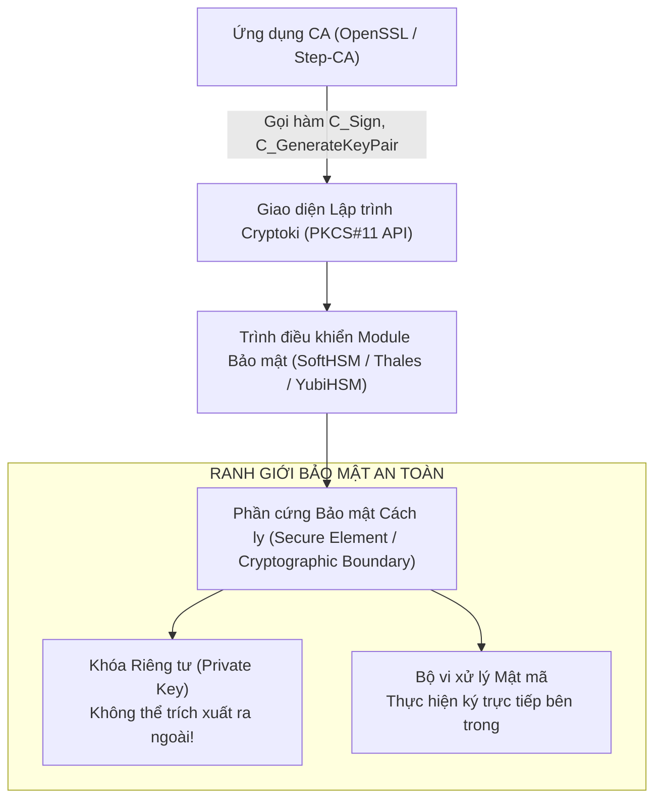
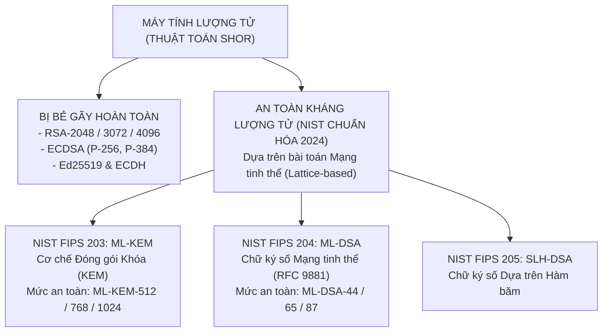
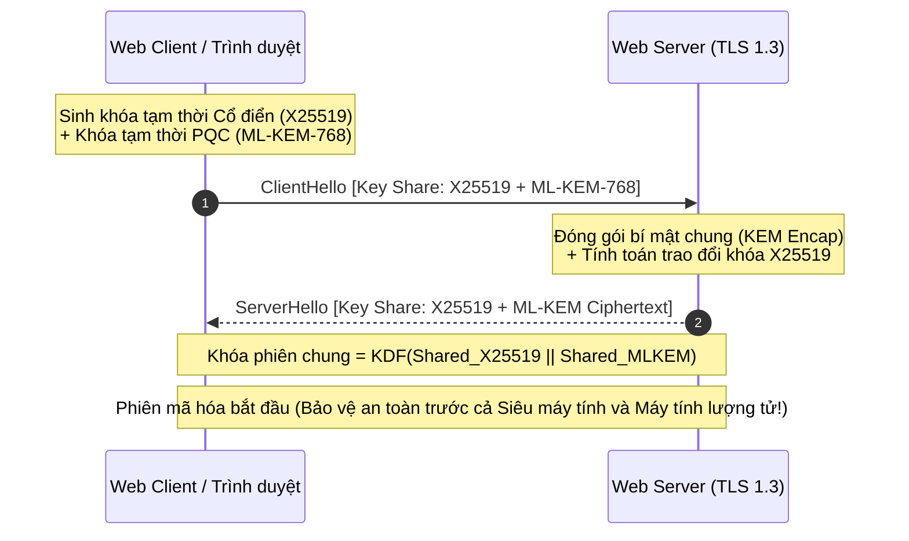

# Handout S05: Bảo vệ Khóa Riêng tư: SoftHSMv2, PKCS#11 & Chuyển dịch Hậu Lượng tử (PQC)

**Học phần:** Cơ sở hạ tầng khóa công khai (ATHK 512) · Lớp CHAT4P  
**Đơn vị:** Khoa An toàn Thông tin — Phân hiệu Học viện Kỹ thuật Mật mã tại TP.HCM  
**Giảng viên:** Nguyễn An Khương (Khoa Khoa học & Kỹ thuật Máy tính, Trường ĐHBK Tp. HCM · [ORCID: 0000-0002-9910-6387](https://orcid.org/0000-0002-9910-6387))  
**Trợ giảng:** Nguyễn Hữu Hoàng Huy  

---

## 1. Cách ly Khóa Riêng tư qua Chuẩn Giao tiếp PKCS#11

Khóa riêng tư của CA không bao giờ được phép xuất hiện dưới dạng văn bản rõ (plaintext) trong bộ nhớ RAM của hệ điều hành:

---

## 2. Mối Đe dọa Lượng tử & Bộ Chuẩn FIPS PQC của NIST (08/2024)

Máy tính lượng tử quy mô lớn ứng dụng thuật toán Shor sẽ giải quyết bài toán logarit rời rạc và phân tích thừa số nguyên trong thời gian đa thức, bẻ gãy hoàn toàn RSA và ECC:

---

## 3. Bắt tay Lai Hậu Lượng tử (Hybrid Key Exchange) trong TLS 1.3

Để bảo đảm tính tương thích và bảo vệ hai lớp (phòng ngừa trường hợp thuật toán PQC mới có lỗ hổng toán học tiềm ẩn), các hệ thống Web PKI tiên tiến áp dụng cơ chế lai:

---

## 4. Tài liệu Tham khảo Chuẩn Quốc tế

1. **OASIS Standard:** *PKCS #11 Cryptographic Token Interface Base Specification Version 3.0*, 2020.
2. **NIST FIPS 203:** *Module-Lattice-Based Key-Encapsulation Mechanism Standard (ML-KEM)*, 2024. [doi.org/10.6028/NIST.FIPS.203](https://doi.org/10.6028/NIST.FIPS.203)
3. **NIST FIPS 204:** *Module-Lattice-Based Digital Signature Standard (ML-DSA)*, 2024. [doi.org/10.6028/NIST.FIPS.204](https://doi.org/10.6028/NIST.FIPS.204)
4. **IETF RFC 9881:** *Use of the ML-DSA Algorithm in Internet X.509 PKI and CRL Profiles*, 2024.
