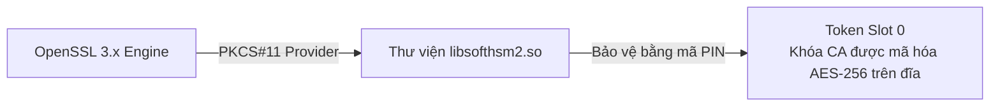

# Slides S05: Bảo vệ Khóa Riêng tư: SoftHSMv2, PKCS#11 & Chuyển dịch PQC

**Học phần:** Cơ sở hạ tầng khóa công khai (ATHK 512) · Lớp CHAT4P  
**Giảng viên:** Nguyễn An Khương (Khoa Khoa học & Kỹ thuật Máy tính, Trường ĐHBK Tp. HCM · [ORCID: 0000-0002-9910-6387](https://orcid.org/0000-0002-9910-6387))  
**Trợ giảng:** Nguyễn Hữu Hoàng Huy  

---

## Slide 1: Khóa Riêng tư Lưu trên Ổ đĩa: Thảm họa Chờ đợi

* Tệp `server.key` lưu dạng văn bản rõ trên máy chủ:
  * Rủi ro bị sao chép trái phép qua lỗ hổng hệ điều hành, backup rò rỉ hoặc nhân viên nội bộ bất hảo.
* **Giải pháp Bắt buộc:** Đưa khóa vào ranh giới phần cứng HSM. Lệnh gọi hàm chỉ gửi dữ liệu băm vào và nhận lại chữ ký số!

---

## Slide 2: Kiến trúc Module SoftHSMv2 trong Phòng Lab

---

## Slide 3: Chiến lược Chuyển dịch Mật mã Hậu lượng tử

* **Nguyên tắc "Thu hoạch ngay, Giải mã sau" (Harvest Now, Decrypt Later):**
  * Kẻ tấn công thu thập toàn bộ lưu lượng TLS được ghi lại ngay từ hôm nay. Khi máy tính lượng tử đủ mạnh xuất hiện, họ sẽ giải mã toàn bộ dữ liệu lịch sử!
* Do đó, quá trình chuyển đổi sang thuật toán lai (Hybrid KEM) cần được triển khai ngay lập tức.
