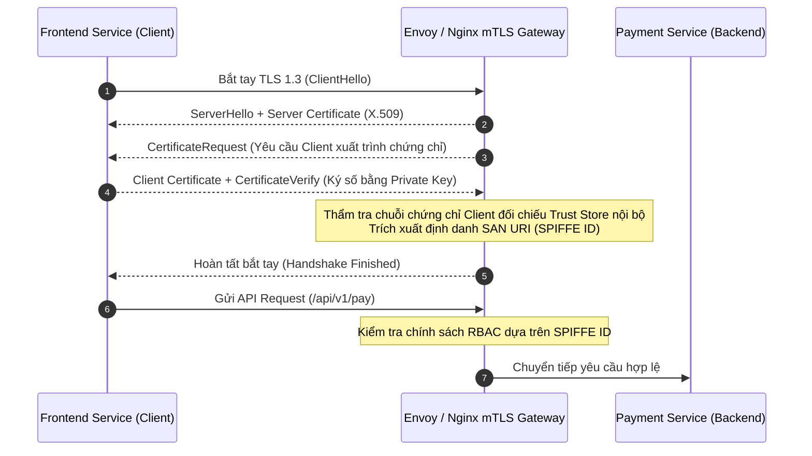

# Handout S06: Kiến trúc Zero Trust & mTLS Gateway trong Hạ tầng Microservices

**Học phần:** Cơ sở hạ tầng khóa công khai (ATHK 512) · Lớp CHAT4P  
**Đơn vị:** Khoa An toàn Thông tin — Phân hiệu Học viện Kỹ thuật Mật mã tại TP.HCM  
**Giảng viên:** Nguyễn An Khương (Khoa Khoa học & Kỹ thuật Máy tính, Trường ĐHBK Tp. HCM · [ORCID: 0000-0002-9910-6387](https://orcid.org/0000-0002-9910-6387))  
**Trợ giảng:** Nguyễn Hữu Hoàng Huy  

---

## 1. Nguyên lý Kiến trúc Zero Trust (NIST SP 800-207)

Mô hình an ninh truyền thống dựa trên ranh giới mạng ("bên ngoài không tin cậy, bên trong mạng LAN tin cậy hoàn toàn") đã lỗi thời. Kiến trúc **Zero Trust** tuân thủ nguyên lý:
* **Không bao giờ tin tưởng, luôn luôn xác thực (Never Trust, Always Verify):** Mọi yêu cầu kết nối, dù đến từ bên trong hay bên ngoài trung tâm dữ liệu, đều phải được xác thực danh tính và kiểm soát quyền hạn.
* **Định danh Số là Ranh giới An ninh Mới:** Mỗi dịch vụ (Service Account, Microservice, Pod) phải có một danh tính mật mã duy nhất thể hiện qua chứng chỉ số X.509.

---

## 2. Xác thực Hai chiều Mutual TLS (mTLS) trong Microservices

---

## 3. Chuẩn Định danh SPIFFE / SPIRE

Chuẩn **SPIFFE (Secure Production Identity Framework for Everyone)** định nghĩa định dạng định danh tiêu chuẩn cho các dịch vụ đám mây:
* **SPIFFE ID:** Định dạng URI chuẩn mực: `spiffe://<trust-domain>/ns/<namespace>/sa/<service-account>`.
  * Ví dụ: `spiffe://kma.edu.vn/ns/production/sa/payment-worker`.
* **X.509 SVID (SPIFFE Verifiable Identity Document):** Chứng chỉ số X.509 chứa SPIFFE ID nhúng trực tiếp trong trường mở rộng `Subject Alternative Name (SAN)` kiểu URI.

---

## 4. Tài liệu Tham khảo Chuẩn Quốc tế

1. **NIST SP 800-207:** *Zero Trust Architecture*, National Institute of Standards and Technology, 2020. [doi.org/10.6028/NIST.SP.800-207](https://doi.org/10.6028/NIST.SP.800-207)
2. **SPIFFE Standard:** *The SPIFFE Identity and Verifiable Identity Document Specification*, Cloud Native Computing Foundation (CNCF), 2023. [spiffe.io](https://spiffe.io)
3. **IETF RFC 8446:** *The Transport Layer Security (TLS) Protocol Version 1.3*, 2018.
