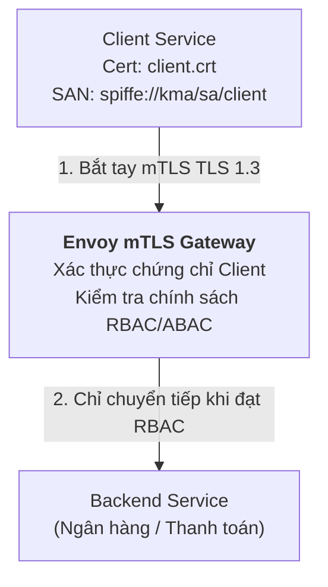

# Slides S06: Kiến trúc Zero Trust & mTLS Gateway trong Hạ tầng Microservices

**Học phần:** Cơ sở hạ tầng khóa công khai (ATHK 512) · Lớp CHAT4P  
**Giảng viên:** Nguyễn An Khương (Khoa Khoa học & Kỹ thuật Máy tính, Trường ĐHBK Tp. HCM)  
**Trợ giảng:** Nguyễn Hữu Hoàng Huy  

---

## Slide 1: Sự Đổ vỡ của Mô hình Ranh giới Vành đai (Perimeter Security)

* Hacker chỉ cần vượt qua tường lửa hoặc chiếm được một máy trạm nội bộ qua mã độc lừa đảo (phishing) là có thể di chuyển ngang (Lateral Movement) tự do khắp mạng LAN!
* **Zero Trust:** Xóa bỏ khái niệm "mạng nội bộ an toàn". Mọi gói tin truyền qua mạng đều phải được mã hóa và xác thực chữ ký số mTLS.

---

## Slide 2: Khác biệt giữa TLS 1 Chiều và mTLS 2 Chiều

* **TLS 1 chiều (Standard Web HTTPS):** Chỉ người dùng kiểm tra chứng chỉ của máy chủ. Máy chủ không biết người dùng là ai ở tầng mạng.
* **Mutual TLS (mTLS):** Cả máy chủ và máy khách đều phải xuất trình chứng chỉ X.509 hợp lệ được cấp bởi CA chung của tổ chức.

---

## Slide 3: Kiến trúc Zero Trust Mesh với Envoy Gateway

