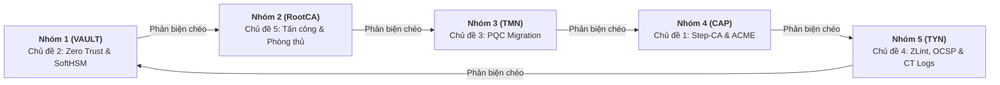

# Handout S07: Đánh giá Tiến độ Đồ án Giữa kỳ & Thẩm định Thiết kế Kiến trúc

**Học phần:** Cơ sở hạ tầng khóa công khai (ATHK 512) · Lớp CHAT4P  
**Đơn vị:** Khoa An toàn Thông tin — Phân hiệu Học viện Kỹ thuật Mật mã tại TP.HCM  
**Giảng viên:** Nguyễn An Khương (Khoa Khoa học & Kỹ thuật Máy tính, Trường ĐHBK Tp. HCM · [ORCID: 0000-0002-9910-6387](https://orcid.org/0000-0002-9910-6387))  
**Trợ giảng:** Nguyễn Hữu Hoàng Huy  

---

## 1. Mục tiêu Kiểm soát Mốc Tiến độ Giữa kỳ (Midterm Milestone Gate)

Mốc đánh giá giữa kỳ tại Buổi S07 nhằm bảo đảm:
1. Các nhóm đã hiện thực hóa được tối thiểu 50% khối lượng kỹ thuật trong môi trường Docker container.
2. Kiến trúc phân tầng CA tuân thủ đúng các nguyên tắc an toàn bất biến (Air-gapped Root, Path length constraint, Key Usage).
3. Bản thảo quy chế CP/CPS sơ bộ theo chuẩn RFC 3647 phản ánh chính xác cấu trúc hệ thống.
4. Phát hiện sớm các lỗi sai lệch kiến trúc hoặc rủi ro triển khai trước khi bước vào giai đoạn hoàn thiện cuối kỳ.

---

## 2. Ma trận Chấm chéo Đánh giá Ngang hàng Giữa 5 Nhóm Kỹ thuật

---

## 3. Khung Phân tích Mô hình Đe dọa STRIDE cho Hệ thống CA

Mỗi nhóm phải trình bày mô hình đe dọa STRIDE đối với hệ thống của mình:
* **S (Spoofing Identity):** Nguy cơ kẻ tấn công giả mạo danh tính yêu cầu cấp chứng chỉ.
* **T (Tampering with Data):** Nguy cơ can thiệp làm sai lệch bản ghi log CT hoặc cấu hình OpenSSL.
* **R (Repudiation):** Nguy cơ quản trị viên chối bỏ việc đã phát hành chứng chỉ độc hại (giải quyết bằng chữ ký số và CT Log).
* **I (Information Disclosure):** Nguy cơ rò rỉ khóa riêng tư ra khỏi bộ nhớ hoặc tệp đĩa.
* **D (Denial of Service):** Nguy cơ làm sập máy chủ OCSP Responder hoặc máy chủ ACME.
* **E (Elevation of Privilege):** Nguy cơ lạm dụng mở rộng EKU để leo thang đặc quyền quản trị viên.

---

## 4. Tài liệu Tham khảo Chuẩn Quốc tế

1. **IEEE Standard 1012-2016:** *IEEE Standard for System, Software, and Hardware Verification and Validation*, IEEE, 2017.
2. **Microsoft Threat Modeling Framework & STRIDE Methodology.**
3. **Common Vulnerability Scoring System (CVSS) v3.1 Specification.**
