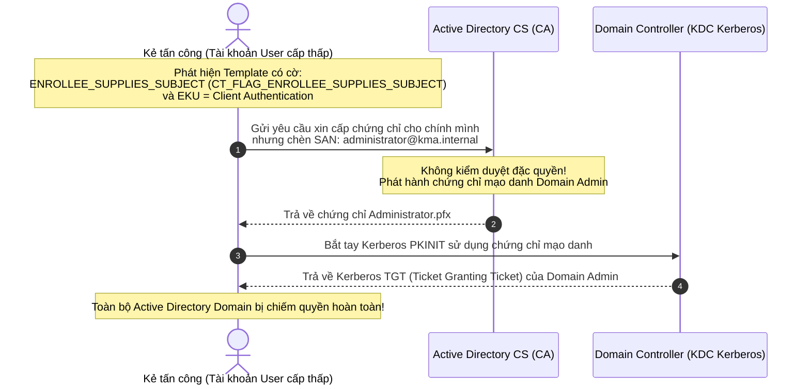
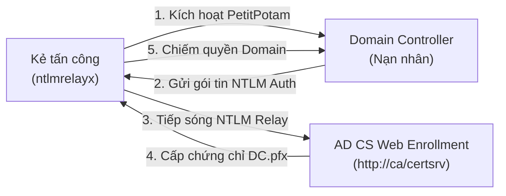
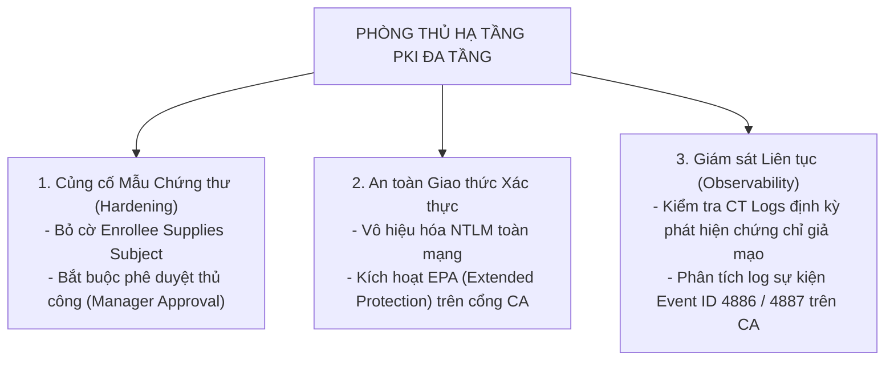

# Handout S08: Mô phỏng Tấn công & Phòng thủ Hạ tầng PKI (AD CS, Rogue CA, MitM)

**Học phần:** Cơ sở hạ tầng khóa công khai (ATHK 512) · Lớp CHAT4P  
**Đơn vị:** Khoa An toàn Thông tin — Phân hiệu Học viện Kỹ thuật Mật mã tại TP.HCM  
**Giảng viên:** Nguyễn An Khương (Khoa Khoa học & Kỹ thuật Máy tính, Trường ĐHBK Tp. HCM · [ORCID: 0000-0002-9910-6387](https://orcid.org/0000-0002-9910-6387))  
**Trợ giảng:** Nguyễn Hữu Hoàng Huy  

---

## 1. Bề mặt Tấn công Khai thác Lỗ hổng Cấu hình Mẫu Chứng thư (AD CS ESC1)

Trong môi trường Active Directory Certificate Services (AD CS), cấu hình sai mẫu chứng thư (Certificate Template) là con đường ngắn nhất để kẻ tấn công chiếm toàn quyền kiểm soát miền (Domain Admin):

---

## 2. Kỹ thuật Tấn công Tiếp sóng NTLM Relay vào Web Enrollment (ESC8)

Kẻ tấn công ép buộc máy chủ Domain Controller xác thực ngược lại máy mình thông qua giao thức RPC (PetitPotam / MS-EFSRPC), sau đó chuyển tiếp (relay) bản tin xác thực NTLM tới dịch vụ AD CS Web Enrollment (chưa bật HTTPS hoặc thiếu Extended Protection for Authentication - EPA) để lấy chứng chỉ quản trị máy tính:

---

## 3. Kiến trúc Phòng thủ Đa tầng (Defense in Depth for PKI)

---

## 4. Tài liệu Tham khảo Chuẩn Quốc tế

1. **Will Schroeder & Lee Christensen:** *Certified Pre-Owned: Abusing Active Directory Certificate Services*, SpecterOps Whitepaper, 2021.
2. **CISA Alert AA22-321A:** *Stop Ransomware: Misconfigured Active Directory Certificate Services*, Cybersecurity and Infrastructure Security Agency, 2022.
3. **MITRE ATT&CK:** *Technique T1649: Steal or Forge Authentication Certificates*. [attack.mitre.org/techniques/T1649](https://attack.mitre.org/techniques/T1649)
