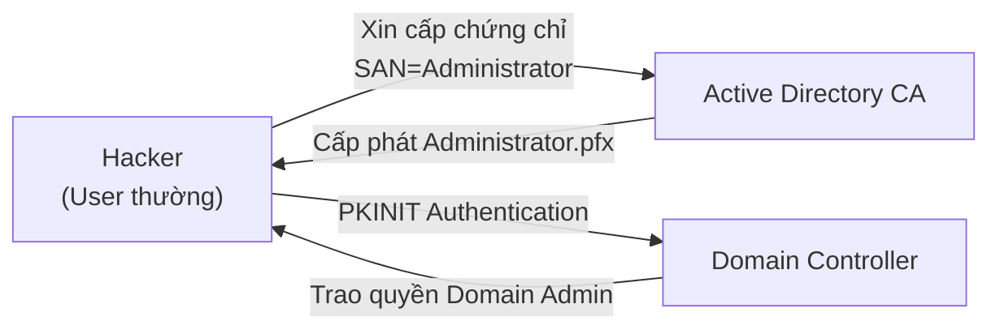

# Slides S08: Mô phỏng Tấn công & Phòng thủ Hạ tầng PKI

**Học phần:** Cơ sở hạ tầng khóa công khai (ATHK 512) · Lớp CHAT4P  
**Giảng viên:** Nguyễn An Khương (Khoa Khoa học & Kỹ thuật Máy tính, Trường ĐHBK Tp. HCM)  
**Trợ giảng:** Nguyễn Hữu Hoàng Huy  

---

## Slide 1: PKI - Mục tiêu Số 1 của Kẻ Tấn công Nâng cao (APT)

* Thay vì bẻ gãy thuật toán mật mã bằng toán học, kẻ tấn công luôn tìm kiếm **lỗ hổng cấu hình và sai sót quy trình vận hành**.
* Chiếm được CA đồng nghĩa với việc nắm giữ "chiếc chìa khóa vạn năng" để giả mạo mọi dịch vụ trong hệ thống.

---

## Slide 2: Kịch bản Khai thác AD CS ESC1

---

## Slide 3: Chiến lược Vá lỗi và Khắc phục

* Bỏ ngay tùy chọn `ENROLLEE_SUPPLIES_SUBJECT` trên các mẫu chứng thư nhạy cảm.
* Yêu cầu chữ ký số của người phê duyệt (Authorized Signature / Manager Approval).
* Giám sát mọi yêu cầu xin cấp chứng thư có chứa SAN bất thường.
