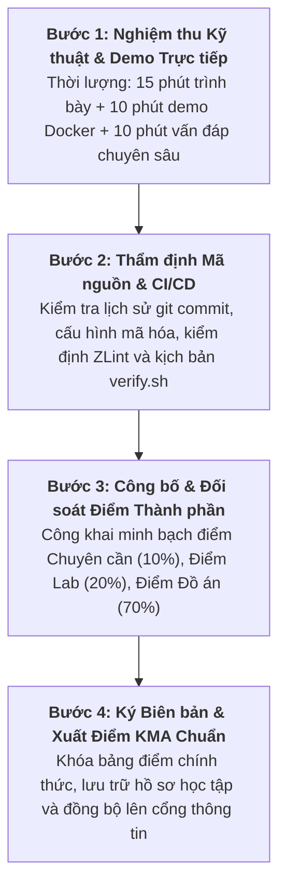

# Handout S09: Báo cáo Tổng kết Đồ án Chuyên sâu & Đối soát Điểm Công khai

**Học phần:** Cơ sở hạ tầng khóa công khai (ATHK 512) · Lớp CHAT4P  
**Đơn vị:** Khoa An toàn Thông tin — Phân hiệu Học viện Kỹ thuật Mật mã tại TP.HCM  
**Giảng viên:** Nguyễn An Khương (Khoa Khoa học & Kỹ thuật Máy tính, Trường ĐHBK Tp. HCM)  
**Trợ giảng:** Nguyễn Hữu Hoàng Huy  

---

## 1. Mục đích Buổi Tổng kết Đồ án Chuyên sâu (Capstone Defense)

Buổi S09 là mốc nghiệm thu toàn diện kết quả học tập và nghiên cứu thực nghiệm của học viên trong suốt học kỳ:
* Đánh giá năng lực làm chủ kỹ thuật hệ thống mật mã qua việc bảo vệ đồ án trực tiếp trước Hội đồng.
* Trình diễn trực quan sản phẩm phần mềm vận hành thực tế trong môi trường Docker container.
* Thực hiện đối soát minh bạch từng cột điểm thành phần và chốt bảng điểm chính thức trước khi gửi về Ban Đào tạo Sau đại học.

---

## 2. Quy trình Nghiệm thu và Đối soát Điểm 4 Cấp

---

## 3. Khung Tiêu chí Đánh giá Đồ án Cuối kỳ (Thang điểm 10.0)

Hội đồng thẩm định dựa trên 4 trụ cột chuyên môn:

| Trụ cột Chuyên môn | Trọng số | Nội dung Đánh giá Chi tiết |
|---|:---:|---|
| **1. Hạ tầng Kỹ thuật & Tự động hóa** | **30%** | Môi trường Docker hoàn chỉnh, kịch bản tự động hóa 1-chạm (`verify.sh`), cấu hình phân tầng CA chuẩn mực, không lỗi cú pháp. |
| **2. Tuân thủ Tiêu chuẩn Quốc tế** | **25%** | Tuân thủ chính xác các tiêu chuẩn IETF RFC (5280, 8555, 6960, 6962, 9881) và NIST FIPS (203, 204). Bản quy chế CP/CPS hoàn chỉnh. |
| **3. Dữ liệu Thực nghiệm & Đo kiểm** | **25%** | Bảng số liệu đo lường định lượng thực tế (kích thước khóa, độ trễ bắt tay, thông lượng, phân mảnh gói tin mạng). Báo cáo phân tích chuyên sâu. |
| **4. Báo cáo Học thuật & Vấn đáp** | **20%** | Báo cáo kỹ thuật trình bày khoa học, chuẩn trích dẫn, trả lời tự tin, bảo vệ vững chắc các luận điểm kỹ thuật trước Hội đồng. |

---

## 4. Tài liệu Tham khảo Chuẩn Quốc tế

1. **Quy chế Đào tạo Trình độ Thạc sĩ:** Phân hiệu Học viện Kỹ thuật Mật mã tại TP.HCM.
2. **IEEE Standards Style Manual:** *Guidelines for Authoring Technical and Engineering Reports*, IEEE, 2022.
